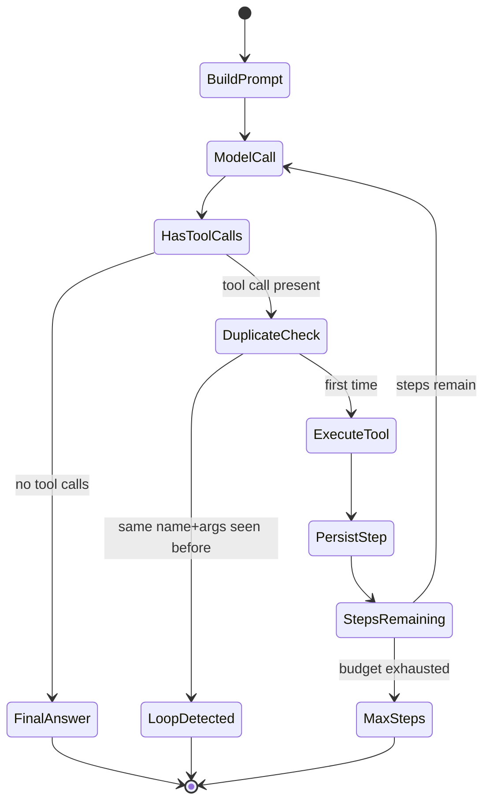

# Agent and tools

The agent is a bounded, tool-calling execution loop implemented in
`backend/app/ai/agent/`. It turns a natural-language goal into real, auditable
changes in the knowledge base.

## 1. The architecture rule

> An agent can **never** touch the database directly. It may only call a
> registered `Tool`, and every tool goes through `Service` → `Repository` →
> database.

Tools are the only write path an agent has. This is what makes the agent
auditable and safe: every side-effect is a named tool call with recorded
arguments, a result, a status and a latency.

## 2. Tool interface contract

Every tool subclasses `Tool` (`app/ai/agent/tools.py`):

```python
class Tool(ABC):
    spec: ClassVar[ToolSpec]
    is_write: ClassVar[bool] = False

    @abstractmethod
    async def execute(self, ctx: ToolContext, **kwargs) -> ToolResult: ...

    def validate(self, arguments: dict) -> dict: ...   # schema-driven
    async def run(self, ctx, arguments) -> ToolResult: # validate + cap + execute
```

* `spec` is a `ToolSpec(name, description, parameters, category,
  requires_confirmation)`; `parameters` is a JSON Schema object
  (`{"type": "object", "properties": {...}, "required": [...]}`).
* `validate()` enforces required parameters, coerces string→int/float where the
  schema says so, parses JSON strings into arrays, **ignores hallucinated
  parameters** rather than failing, and applies schema defaults.
* `run()` calls `validate()`, consumes a write slot when `is_write`, executes,
  and stamps `latency_ms`. All `AppError`s become `ToolResult(ok=False, error=...)`
  — a tool failure never crashes the loop; an unexpected exception is logged with
  a stack trace (`tool_crashed`) and also becomes a failed result.
* `ToolContext` carries `session`, `owner_id`, `project_id`, `knowledge_base_ids`,
  `run_id`, `max_write_ops` (default 40), `write_ops`, and `artifacts`. It exposes
  `consume_write()` (raises `ToolExecutionError` past the cap) and
  `register_artifact(kind, id)`.

## 3. Tool catalogue

Eleven tools are registered by `build_default_registry()`. `GET /agents/tools`
returns the live catalogue with `name`, `description`, `category`, `parameters`
and `is_write`.

| Tool | Category | Write | Purpose |
|---|---|---|---|
| `knowledge_search` | read | no | Hybrid search inside the knowledge base |
| `document_read` | read | no | Read a document's text (bounded by `max_chars`) |
| `task_list` | read | no | List existing tasks (avoid duplicates) |
| `project_list` | read | no | List projects for assignment |
| `calculator` | utility | no | AST-restricted arithmetic |
| `task_planner` | ai | no | Generate a phased plan from a goal (does not persist) |
| `task_create` | write | yes | Create one task |
| `task_create_batch` | write | yes | Create a task tree from a plan/goal |
| `task_update` | write | yes | Change status/priority/estimates/criteria |
| `note_create` | write | yes | Persist a Markdown note (optionally AI-generated) |
| `knowledge_link` | write | yes | Link a document to a task |

### Parameter schemas

| Tool | Required | Optional (defaults) |
|---|---|---|
| `knowledge_search` | `query` | `limit` (6, clamped 1–12) |
| `document_read` | `document_id` | `max_chars` (6000) |
| `task_list` | — | `status`, `limit` (30, clamped 1–100) |
| `project_list` | — | — |
| `calculator` | `expression` | — |
| `task_planner` | `goal` | `horizon_days` (30) |
| `task_create` | `title` | `description` (""), `priority` ("MEDIUM"), `estimated_minutes` (0), `due_date`, `completion_criteria` ("") |
| `task_create_batch` | `from_goal` | `horizon_days` (30), `project_id` |
| `task_update` | `task_id` | `status`, `priority`, `estimated_minutes`, `actual_minutes`, `completion_criteria` |
| `note_create` | `title` | `content_md` (""), `from_goal`, `project_id` |
| `knowledge_link` | `task_id`, `document_id` | `relevance` (1.0) |

### Notes on specific tools

* **`calculator`** uses `safe_eval`, an AST-restricted evaluator. It allows only
  `+ - * / // % **` and unary `+/-`, rejects expressions longer than 200 chars,
  rejects division by zero, and rejects exponents with `|right| > 64`. It never
  calls Python `eval`.
* **`task_create_batch`** calls `PlannerService.generate_plan()` then
  `PlannerService.persist_plan()`; it registers every created task id as an
  artifact.
* **`note_create`** with an empty `content_md` and a non-empty `from_goal` calls
  `DocumentService.generate_note()`, which retrieves context and produces a
  structured Markdown note; the resulting `run_id` is stored and
  `is_ai_generated` is set.
* **`knowledge_link`** calls `TaskService.link_document()`, writing a
  `task_documents` row — the knowledge↔task edge.

## 4. The execution loop

`app/ai/agent/executor.py`, class `AgentExecutor`.



1. **Build the system prompt** from the versioned `agent_system` template with the
   live tool catalogue injected, the goal, the context and `max_steps`.
2. **Ask the model** for the next action with `temperature=0.0`,
   `max_tokens=min(AI_MAX_TOKENS, 1600)` and the tool specs. Native tool calling is
   used when the provider supports it; the offline engine returns one deterministic
   call per step.
3. **At most one tool per step** is executed.
4. The observation is appended as a `tool` message and the loop repeats.

### Termination conditions

| `stopped_reason` | Trigger |
|---|---|
| `final_answer` | The model returned no tool calls and non-empty content |
| `empty_response` | The model returned no tool calls and empty content |
| `loop_detected` | The same `name + sorted(arguments)` signature was seen before |
| `max_steps` | The step budget was exhausted |

The duplicate-call guard hashes the call signature
(`f"{name}:{json.dumps(arguments, sort_keys=True)}"`) and, on the second
occurrence, records a `SKIPPED` tool call with the reason `duplicate call` and
stops. This prevents an infinite loop when a model repeats itself.

### Step budget

`steps_allowed = max(1, min(max_steps or DEFAULT_MAX_STEPS, 16))`.
`DEFAULT_MAX_STEPS = 8`. The budget is clamped to 16 even if a larger value is
requested.

## 5. Safety limits

| Limit | Value | Enforcement |
|---|---|---|
| Max steps | 8 default, 16 hard cap | `AgentExecutor.run` |
| One tool per step | 1 | `chat.tool_calls[0]` |
| Write-operation cap | 40 per run | `ToolContext.consume_write` → `ToolExecutionError` |
| Loop detection | 2nd identical call | `seen_calls` signature map |
| Tool argument validation | per-schema | `Tool.validate` |
| Agent DB access | none | architectural (tools only) |
| Ownership checks | per tool | tools call services which check `owner_id` |

## 6. Trace format

Every step is persisted so the whole trajectory is replayable from the AI Run
page.

* `ai_runs`: the parent run (`run_type = AGENT`), prompt name/version, token
  totals, latency, `tool_call_count`, `tools_used`, `result_payload` (steps,
  created entities, stopped_reason).
* `agent_runs` (1:1 with the run): `goal`, `status`, `max_steps`, `steps_used`,
  `scratchpad` (per-step tool/ok/summary/error), `final_answer`,
  `created_entity_ids`.
* `tool_calls`: one row per step with `step_index`, `tool_name`, `arguments`,
  `result`, `status` (`SUCCEEDED` / `FAILED` / `SKIPPED`), `error_message`,
  `latency_ms`.

`GET /api/v1/agents/run` returns
`{run_id, status, goal, final_answer, stopped_reason, provider, model,
latency_ms, created: {tasks: [...], notes: [...]}, steps: [{index, thought, tool,
arguments, ok, summary, error, latency_ms}]}`.
`GET /api/v1/agents/runs/{run_id}` returns the stored trajectory.

### Why tool failures must be visible

A real defect found during verification: after service modules were merged, the
agent tools still imported the **old module paths**, so the write tools silently
returned `ok:false`. The lesson is encoded in the design — a tool failure is
never swallowed:

* `Tool.run` returns a `ToolResult` with `ok=False` and an `error` string;
* the executor records the step with `status="FAILED"` and the error message;
* the step appears in the returned `steps[]` and in `agent_runs.scratchpad`.

See [../docs/thesis/09-系统测试.md](thesis/09-系统测试.md) for the full defect list.

## 7. Adding a new tool

Step by step:

1. **Define the class** in `app/ai/agent/tools.py`, subclassing `Tool`.
2. **Declare `spec`** as a `ToolSpec` with a JSON Schema. Set
   `category` to `"read"`, `"write"`, `"ai"` or `"utility"`, and set
   `is_write = True` if it mutates data.
3. **Implement `execute(self, ctx, **kwargs)`**:
   * call a **service** (never a repository or raw SQL);
   * pass `ctx.owner_id` so the service can enforce ownership;
   * return `ToolResult(ok=True, data=..., summary="...")` on success.
4. **Register it** in `build_default_registry()` (the tuple of tool instances).
   The registry rejects duplicate names.
5. **Raise typed errors** for validation problems (`ValidationError`) — `run()`
   converts them to a failed result.
6. **Register artifacts** with `ctx.register_artifact("tasks", str(task.id))` if
   the tool creates entities, so `created` is reported.
7. **Test it** (a unit test for `validate()` and an integration test through
   `/agents/run`). The tool must not appear as a silent failure.
8. Update the tool catalogue table in this document and in
   [api.md](api.md) if the public shape changes.

The agent's system prompt already instructs the model to use only the tools listed
in the injected catalogue, so a newly registered tool becomes available
automatically — no prompt change is required.

## 8. Related documents

* [ai.md](ai.md) — providers and tracing
* [rag.md](rag.md) — the retrieval the tools rely on
* [development.md](development.md) — layering rules

---

## Update — this document describes the business-tool agent

The agent described here calls the eleven business tools: knowledge search, task and
project queries, the planner, and the note and task writers. It is bounded, it cannot
reach the database, and it is still what runs when you use the original agent endpoint.

A second agent was added that operates the machine itself — files, code, git, terminal,
builds, processes, the network — with a plan/execute/verify/fix loop and the full
permission system in front of it.

**That one is documented separately: [`autonomous-agent.md`](autonomous-agent.md).**

The two share the executor's tool plumbing but not their prompts, their limits or their
purpose. Reading one and assuming it describes the other will be misleading, which is why
this note is here rather than a merge.
