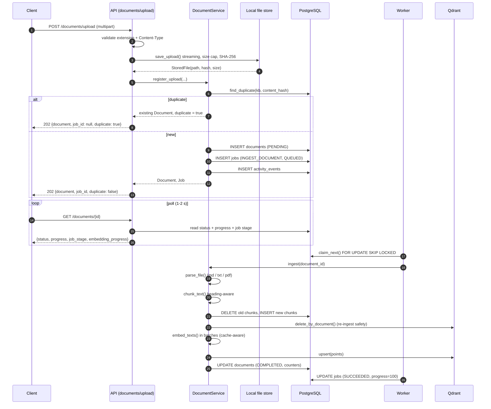
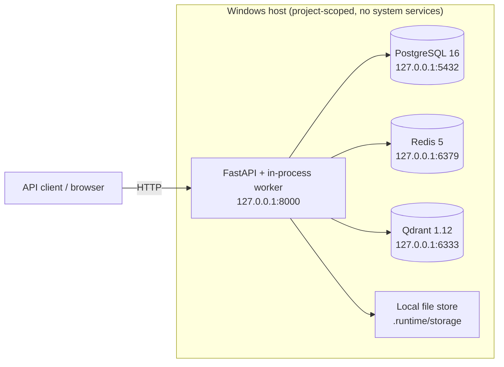

# Architecture

AI Workbench is a local-first AI knowledge and task execution platform. It closes
one loop:

```
资料 → 知识 → 任务 → 执行 → 结果 → 再沉淀为知识
(document → knowledge → task → execution → result → knowledge again)
```

This document describes the layered architecture, the request lifecycle, the
upload data-flow, why the background worker is database-backed, and the
deployment topology. Every component named here exists in the source tree under
`backend/app/`.

## 1. Stack

| Layer | Technology | Where |
|---|---|---|
| Language | Python 3.13 (declared `>=3.11`, `target-version = py311`) | `backend/pyproject.toml` |
| Web framework | FastAPI + Uvicorn | `backend/app/main.py` |
| ORM | SQLAlchemy 2.0 async + `asyncpg` | `backend/app/infrastructure/database.py` |
| Schema | `Base.metadata.create_all` bootstrap + Alembic declared | `backend/app/main.py:_bootstrap_schema` |
| Validation | Pydantic v2 / pydantic-settings | `backend/app/core/config.py`, `backend/app/schemas/` |
| Relational store | PostgreSQL 16 | `DATABASE_URL` |
| Cache | Redis 5 (cache-only, persistence disabled) | `backend/app/core/cache.py` |
| Vector store | Qdrant 1.12 | `backend/app/infrastructure/vector_store.py` |
| Background work | Custom DB-backed worker (no Celery) | `backend/app/worker/runner.py` |

The concrete runtime versions verified on the development machine are listed in
[deployment.md](deployment.md).

## 2. Layered architecture

The codebase enforces a strict one-directional dependency rule. A layer may only
call the layer directly beneath it.

```
        ┌──────────────────────────────────────────────────────────┐
        │  API layer  (app/api/v1/*)                               │
        │  routing, auth dependency, request/response schemas      │
        │  NO business rules, NO SQL                               │
        └───────────────┬──────────────────────────────────────────┘
                        │  service calls
        ┌───────────────▼──────────────────────────────────────────┐
        │  Service layer  (app/services/*)                         │
        │  orchestration, transactions, business rules, AI calls   │
        │  NO raw SQL                                              │
        └───────────────┬──────────────────────────────────────────┘
                        │  repository calls
        ┌───────────────▼──────────────────────────────────────────┐
        │  Repository layer  (app/repositories/*)                  │
        │  the ONLY place that issues SQL                          │
        └───────────────┬──────────────────────────────────────────┘
                        │
        ┌───────────────▼──────────────────────────────────────────┐
        │  Models (app/models/*)  ·  Infrastructure (app/infra/*)  │
        │  22 SQLAlchemy tables    ·  DB engine, file store, Qdrant│
        └──────────────────────────────────────────────────────────┘

        ┌──────────────────────────────────────────────────────────┐
        │  AI layer  (app/ai/*)                                    │
        │  providers · prompts · parsers · rag · agent · tracing   │
        │  called BY services; never calls the API layer           │
        └──────────────────────────────────────────────────────────┘

        ┌──────────────────────────────────────────────────────────┐
        │  Worker  (app/worker/runner.py)                          │
        │  consumes jobs, calls services; a separate process or    │
        │  an in-process task owned by the API lifespan           │
        └──────────────────────────────────────────────────────────┘
```

Layer rules (see [development.md](development.md) for the full list):

1. API routes never import a repository and never write SQL.
2. Services never import `sqlalchemy.select` for their own queries; they call a
   repository. (Aggregate reporting in `stats_service.py` is the documented
   exception, where read-only projections live beside the service that owns
   them.)
3. The agent never touches the database. It may only call a registered tool;
   tools call services; services call repositories.
4. Exceptions are typed (`app/core/errors.py`) and are never swallowed.

### Directory map

| Path | Contents |
|---|---|
| `app/core/` | config, logging, errors, security, retry, cache, dates, response envelope |
| `app/domain/enums.py` | shared enumerations |
| `app/models/` | 22 SQLAlchemy tables in 7 modules |
| `app/repositories/` | `base.py`, `knowledge_repo.py`, `work_repo.py`, `ai_repo.py` |
| `app/services/` | auth, workspace, task, document, ai, stats |
| `app/ai/providers/` | base, factory, heuristic, ollama, openai_compatible |
| `app/ai/prompts/` | builtin templates + versioned registry |
| `app/ai/parsers/` | Markdown / TXT / PDF parsers |
| `app/ai/rag/` | chunker, embedding, retriever, pipeline |
| `app/ai/agent/` | tools + executor |
| `app/ai/tracing.py` | `RunRecorder` (the AI execution trace) |
| `app/worker/runner.py` | the background worker |
| `app/api/v1/` | routers; `deps.py` for shared dependencies |
| `app/infrastructure/` | database engine, file storage, vector store |

The table above is scoped to `backend/app/`. The repository root also contains
`scripts/` (PowerShell bootstrap + the smoke test), `samples/` (fixture documents),
`vendor/runtime/` (native binaries), `docs/` (this documentation set), and
`frontend/` — a React 18 + Vite 5 + Tailwind project developed as a separate
workstream and not described by these backend docs.

## 3. Request lifecycle

Every HTTP request passes through a single observability middleware and a set of
central exception handlers.

```
client
  │
  ▼
CORSMiddleware ──► GZipMiddleware ──► observability middleware
                                        │ assign request_id (contextvar)
                                        │ start timer
                                        ▼
                                     router → dependency (get_current_user)
                                        │ decode JWT (HS256) → load User
                                        ▼
                                     route handler
                                        │ calls a Service
                                        ▼
                                     service → repository → PostgreSQL
                                        │ (may call the AI layer)
                                        ▼
                                     ok(...) / build_page(...)  → success envelope
  ▲                                     │
  │ X-Request-ID / X-Process-Time-Ms ◄──┘
  │
  └── on error: typed AppError → register_exception_handlers → error envelope
```

Key facts, all verifiable in `app/main.py`:

* `request_id` is generated with `new_request_id()` (16 hex chars) or taken from
  an inbound `X-Request-ID`, stored in a `ContextVar`, and echoed on the response.
* `X-Process-Time-Ms` reports the wall-clock duration of the request.
* One structured log line (`request_completed`) is emitted per request, at
  `WARNING` for status ≥ 400 and `INFO` otherwise.
* The success envelope is `{"success": true, "data": ...}`; the error envelope is
  `{"success": false, "error": {code, message, details}, "request_id": ...}`.
  See [../docs/api.md](api.md) for the full contract.

## 4. Upload data-flow

Uploading a document is the clearest example of the split between the request
path (fast) and the worker path (slow). The HTTP handler only validates, stores
the bytes and enqueues a job; parsing, chunking and embedding happen in the
worker.



Stages reported on the document and the job are `PARSING → CHUNKING →
EMBEDDING → COMPLETED`. A failure anywhere sets the document to `FAILED` with a
human-readable `error_message` (see [database.md](database.md) for the status
state machine).

## 5. Why the worker is database-backed

`app/worker/runner.py` and `app/repositories/ai_repo.py:JobRepository` implement a
queue on top of the `jobs` table. Celery/RQ/Arq were deliberately not used.
Reasons, from the module docstring and the code:

1. **Windows-native.** The development machine runs Windows without Docker; a
   DB-backed queue needs no broker daemon and no `fork`.
2. **Transactional enqueue.** The job row is inserted in the same transaction as
   the `documents` row, so a document can never be "saved but never processed".
3. **Safe concurrent claiming.** `SELECT ... FOR UPDATE SKIP LOCKED`
   (`JobRepository.claim_next`) lets several workers share the table without an
   external broker.
4. **UI-queryable state.** `attempts`, `stage`, `progress`, `error_message`,
   `locked_by` are ordinary columns the upload page can poll directly.

Reliability features implemented in the worker:

| Feature | Implementation |
|---|---|
| Bounded attempts | `worker_max_attempts` (default 3) per job |
| Exponential backoff | `delay = min(300, 5 * 2**(attempts-1))` seconds, written to `scheduled_at` |
| Stale-job recovery | `JobRepository.requeue_stale()` requeues `RUNNING` jobs older than `worker_stale_job_seconds` (900) on startup |
| Per-job timeout | `asyncio.timeout(settings.worker_job_timeout_seconds)` (900 s) |
| Graceful shutdown | `request_stop()` sets an event; `_drain()` awaits in-flight tasks |

### The event-loop starvation bug (found and fixed)

The main loop calls `_fill_slots()`, which returns **0 both when the queue is
empty and when every worker slot is busy**. The original loop treated `0` as
"nothing to do, try again immediately" and looped without awaiting anything. A
coroutine that never awaits never yields, so the event loop could not schedule
the already-created job tasks — and when the worker runs in-process
(`WORKER_ENABLED=true`, the default) the whole process, including the API,
froze.

The fix is in `Worker.start()`: when no work is claimed, the loop always yields
for the poll interval instead of spinning.

```python
if claimed:
    await asyncio.sleep(0)   # let the freshly created job tasks start
    continue

# Always yield for the poll interval, even if the reason was "all slots busy".
with contextlib.suppress(asyncio.TimeoutError):
    await asyncio.wait_for(self._stop.wait(), timeout=settings.worker_poll_interval)
```

This is a real defect that was reproduced and fixed during verification. It is
also documented as an engineering lesson in
[../docs/thesis/09-系统测试.md](thesis/09-系统测试.md).

## 6. AI layer

The AI layer is a set of libraries, not a service. Services call into it.

```
app/ai/
├── types.py            provider-agnostic value objects (ChatMessage, ChatResult,
│                       EmbeddingResult, RetrievedChunk, ToolSpec, ToolResult, Usage)
├── providers/
│   ├── base.py         LLMProvider / EmbeddingProvider abstract interfaces
│   ├── factory.py      config → concrete provider; graceful degradation
│   ├── heuristic.py    deterministic offline engine (default fallback)
│   ├── ollama.py       fully-local Ollama backend
│   └── openai_compatible.py   any OpenAI-compatible endpoint
├── prompts/
│   ├── builtin.py      9 seed templates (data, not code)
│   └── registry.py     versioned lookup + cache
├── parsers/documents.py  Markdown / TXT / PDF → ParsedDocument
├── rag/
│   ├── chunker.py      heading-aware chunking
│   ├── embedding.py    batched, content-hash cached embedding
│   ├── retriever.py    dense + sparse + fusion + lexical rerank
│   └── pipeline.py     rewrite → retrieve → assemble → generate → cite
├── agent/
│   ├── tools.py        11 tools + registry
│   └── executor.py     bounded ReAct-style loop
└── tracing.py          RunRecorder → ai_runs / tool_calls / ai_run_sources
```

The factory (`app/ai/providers/factory.py`) is the single place where
configuration becomes a provider. When a cloud provider is configured without a
key, it degrades to the offline engine and records `degraded: true` plus a
reason. Details are in [ai.md](ai.md), [rag.md](rag.md) and [agent.md](agent.md).

## 7. Deployment topology

The product runs as **native, project-scoped processes**. Docker is deliberately
not used on the development machine (Docker Desktop is absent and the Docker Hub
registry is unreachable), so PostgreSQL, Redis and Qdrant are downloaded as
native Windows binaries into `vendor/runtime/` and started by
`scripts/infra-start.ps1`.



* **Infrastructure** is started by `scripts/infra-start.ps1` (idempotent: it
  initialises the PostgreSQL cluster on first run and provisions the
  `aiworkbench` role and database).
* **Application processes** are started by `scripts/dev.ps1 start`, which writes
  PID files to `.runtime/pids` and logs to `.runtime/logs`. Nothing is installed
  as a Windows service.
* **The worker** runs in-process by default (`WORKER_ENABLED=true`, started in
  the FastAPI `lifespan`). It can also run as a separate process:
  `python -m app.cli worker`.

### Containerised deployment

A `docker-compose.yml` is **not included in this repository snapshot**, and
containerised deployment has **not been verified on the development machine**.
Docker was intentionally excluded because it was unavailable there. The scripts
under `scripts/` are the supported and verified way to run the stack. Anyone who
wants a container deployment should treat it as new, unverified work. This
limitation is stated again in [deployment.md](deployment.md) and
[../docs/thesis/10-总结与展望.md](thesis/10-总结与展望.md).

## 8. Cross-cutting concerns

| Concern | Implementation | File |
|---|---|---|
| Correlation ids | `request_id` (per request) and `run_id` (per AI run) in `ContextVar`s | `core/logging.py` |
| Structured logs | one-line console or JSON, secret redaction, reserved-key guard | `core/logging.py` |
| Error taxonomy | typed `AppError` subclasses with stable `code` + HTTP status | `core/errors.py` |
| Retry | bounded attempts, exponential backoff + jitter, `max_elapsed` | `core/retry.py` |
| Cache | Redis with documented TTLs and namespace-version invalidation | `core/cache.py` |
| Config | Pydantic settings from `.env`; 12-factor | `core/config.py` |
| Response envelope | `ok()` / `build_page()` | `core/response.py` |

## 9. Related documents

* [database.md](database.md) — the 22 tables, keys, indexes and cascades
* [ai.md](ai.md) — provider abstraction and the offline engine
* [rag.md](rag.md) — the ten-stage retrieval pipeline
* [agent.md](agent.md) — the tool catalogue and the execution loop
* [deployment.md](deployment.md) — running the stack
* [security.md](security.md) — threat model and implemented controls
* [development.md](development.md) — layering rules and how to extend the system

---

## Update — autonomous agent, personal context, desktop shell

The layering below is unchanged. Three subsystems were added on top of it, and each
respects the same boundaries.

### Autonomous agent

`app/ai/agent/` gained four modules beyond the original single-step executor:

| Module | Responsibility |
|---|---|
| `plan.py` | `ExecutionPlan`, `PlanStep`, `RunState`, `RunEvent`. States are one enum, not a pile of booleans — the impossible combinations are where the bugs live. |
| `control.py` | Pause, resume, cancel and the live event stream. Cancel cancels the running asyncio task, which propagates into the process runner and kills the child tree. |
| `snapshot.py` | Capture, diff and restore. Records both the pre-run and the post-run manifest, which is what lets rollback tell the agent's edits from the user's. |
| `autonomous.py` | The loop itself, bounded on every axis. |

The design rule that shapes all of it: **the model decides what to do, the code decides
whether it worked.** Verification is a tool call whose exit code is read. See
[`autonomous-agent.md`](autonomous-agent.md).

### Personal context

`app/ai/memory/` and `app/models/context.py`. Four things kept strictly apart:

```
Profile      who the user is           one row, always loaded, compressed
Memory       facts worth keeping       few, confirmed, scored
Knowledge    files the user supplied   the existing RAG system, untouched
Project      what they are working on  derived from projects/tasks, not new
```

`evaluator.py` decides what is worth remembering and refuses to guess.
`assembler.py` builds the context block a model call receives, under a hard token budget,
and writes the exact rendered text to `context_snapshots`.

Five new tables: `user_profile`, `user_preferences`, `memory_entries`,
`memory_candidates`, `context_snapshots` (migration `1867e3419108`).

### Desktop shell

`desktop/src-tauri/` is a Windows host, not a second application. It owns exactly three
things: the native window, starting the backend, and stopping it. It contains no business
logic.

Two modules worth knowing:

- `lifecycle.rs` — a lifecycle log written to an absolute path with a temp fallback, and a
  job object with `KILL_ON_JOB_CLOSE`. The services are started detached, so
  `taskkill /T` cannot reach them; the job object makes the operating system clean up even
  on a force-kill.
- `menu.rs` — the native menu. Item ids are shared constants between the builder and the
  handler, because a mismatch there fails silently.

### Where the new code sits in the layer diagram

```
Tauri shell  ─────────────────────  no business logic
    │
FastAPI api/ ─────────────────────  new: /profile, /memories, /memory-candidates,
    │                                     /preferences, /context/*
services/    ─────────────────────  new: autonomous_service, wiring in ai_services
repositories/ ────────────────────  unchanged
models/      ─────────────────────  new: context.py (5 tables, 29 total)
    │
Agent → Tool → Permission Manager → Tool Executor
                                        │
                          Computer tools (44, was 42)
                          new: document_write, document_read
```

---

## Update (round 5) — the three layers, named

The layer diagram above is a technical stack. The product-level reading of the same
system is three layers, and it is the reading that explains why the boundaries are where
they are:

```
交付层  delivery    what it produced      BuildRun · Deliverable · verification · acceptance
行动层  action      what it can do        planner · loop · tools · permissions · executor
认知层  cognition   what it knows         documents · concepts · RAG · memory · preferences
```

The rule that separates them is not "which module is allowed to import which". It is:

- the **agent never touches the database** — it calls a named tool, and the tool is
  checked, executed, audited and bounded before any business code runs;
- the **machine decides whether work succeeded** — verification is a tool call whose exit
  code is read, never the model's opinion;
- the **user decides whether the result is wanted** — `accepted` is a separate field from
  `verified`, and a file can pass every check and still be rejected.

That last pair is the load-bearing one. Collapsing them would lose the single most
informative event in the system.

Two other documents belong to this reading: [`../ARCHITECTURE.md`](../ARCHITECTURE.md)
is the ten-minute version, and [`../DELIVERABLE.md`](../DELIVERABLE.md) covers the
delivery model in detail.

### Workspace layout (round 5)

The agent's workspace moved from `%USERPROFILE%\Desktop\AI Workbench Workspace` to
`<project>/.runtime/workspace`, and gained a fixed layout
(`deliverables/ notes/ sources/ .tmp/`). See [`../WORKSPACE.md`](../WORKSPACE.md) for why
the old default was a product defect rather than a configuration choice.
