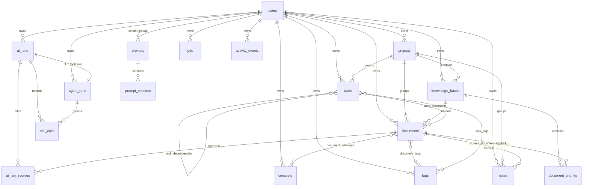

# Database design

The schema is defined by SQLAlchemy 2.0 declarative models under
`backend/app/models/`. There are **22 tables** in 7 modules. Every table is
listed here with its real columns, keys, constraints and indexes as they appear
in the source.

Schema creation on a fresh clone is performed by
`Base.metadata.create_all` inside `app/main.py:_bootstrap_schema`. Alembic is a
declared dependency and the metadata uses a deterministic naming convention so
autogenerate is viable, but **no Alembic revision files are present in this
repository snapshot** (`backend/alembic/versions/` is empty). See
"Schema management" below.

## 1. Conventions

From `app/models/base.py`:

* **Primary keys** are UUID v4 (`UUIDPrimaryKeyMixin`, `Uuid(as_uuid=True)`,
  `default=uuid.uuid4`). Join tables use composite primary keys instead.
* **Timestamps** come from `TimestampMixin`: `created_at` and `updated_at` are
  `DateTime(timezone=True)`, `NOT NULL`, `server_default=func.now()`, with
  `onupdate=func.now()` on `updated_at`. `created_at` is indexed.
* **`eager_defaults = True`** is set on the declarative base. Server-generated
  columns are normally expired after a flush and lazily reloaded, which raises
  `MissingGreenlet` in an async engine when Pydantic serialises the object.
  `eager_defaults` makes SQLAlchemy fetch them in the same INSERT/UPDATE via
  `RETURNING` (native on PostgreSQL), so a freshly flushed row is always safe to
  serialise. This was a real defect found and fixed during verification.
* **Naming convention** (so constraint names are stable):
  `ix_%(table_name)s_%(column_0_N_name)s`, `uq_...`, `ck_...`,
  `fk_%(table_name)s_%(column_0_name)s_%(referred_table_name)s`, `pk_%...`.
* **JSONB** is used for structured payloads (`sqlalchemy.dialects.postgresql.JSONB`).
* `Base.to_dict()` and `__repr__` are provided for debugging.

## 2. Table inventory

| # | Table | Model class | Module |
|---|---|---|---|
| 1 | `users` | `User` | `user.py` |
| 2 | `projects` | `Project` | `project.py` |
| 3 | `knowledge_bases` | `KnowledgeBase` | `knowledge.py` |
| 4 | `documents` | `Document` | `knowledge.py` |
| 5 | `document_chunks` | `DocumentChunk` | `knowledge.py` |
| 6 | `tags` | `Tag` | `knowledge.py` |
| 7 | `document_tags` | `DocumentTag` | `knowledge.py` |
| 8 | `concepts` | `Concept` | `knowledge.py` |
| 9 | `document_concepts` | `DocumentConcept` | `knowledge.py` |
| 10 | `tasks` | `Task` | `task.py` |
| 11 | `task_dependencies` | `TaskDependency` | `task.py` |
| 12 | `task_tags` | `TaskTag` | `task.py` |
| 13 | `task_documents` | `TaskDocument` | `task.py` |
| 14 | `notes` | `Note` | `note.py` |
| 15 | `prompts` | `Prompt` | `ai.py` |
| 16 | `prompt_versions` | `PromptVersion` | `ai.py` |
| 17 | `ai_runs` | `AIRun` | `ai.py` |
| 18 | `agent_runs` | `AgentRun` | `ai.py` |
| 19 | `tool_calls` | `ToolCall` | `ai.py` |
| 20 | `ai_run_sources` | `AIRunSource` | `ai.py` |
| 21 | `jobs` | `Job` | `job.py` |
| 22 | `activity_events` | `ActivityEvent` | `job.py` |

## 3. Entity-relationship diagram



## 4. Table-by-table reference

Notation: **PK** primary key, **FK** foreign key, **UQ** unique, **IX** index,
**NN** not null.

### 4.1 `users`

| Column | Type | Notes |
|---|---|---|
| `id` | UUID | PK |
| `email` | String(255) | NN, UQ, IX |
| `username` | String(64) | NN, UQ, IX |
| `display_name` | String(128) | NN, default `""` |
| `hashed_password` | String(255) | NN (bcrypt, cost 12) |
| `is_active` | Boolean | NN, default `true` |
| `is_superuser` | Boolean | NN, default `false` |
| `avatar_color` | String(16) | NN, default `#6366f1` |
| `created_at`, `updated_at` | timestamptz | NN |

Relationship: `projects` (cascade delete-orphan, `lazy="selectin"`).

### 4.2 `projects`

| Column | Type | Notes |
|---|---|---|
| `id` | UUID | PK |
| `owner_id` | UUID | FK → `users.id` **ON DELETE CASCADE**, NN |
| `name` | String(160) | NN |
| `description` | Text | NN, default `""` |
| `icon` | String(64) | NN, default `folder` |
| `color` | String(16) | NN, default `#6366f1` |
| `status` | String(16) | NN, default `ACTIVE` |
| timestamps | timestamptz | NN |

Index: `ix_projects_owner_status` on (`owner_id`, `status`).
Relationships: `knowledge_bases` (cascade delete-orphan); `tasks`, `documents`,
`notes` (no cascade — their `project_id` is `SET NULL`).

### 4.3 `knowledge_bases`

| Column | Type | Notes |
|---|---|---|
| `id` | UUID | PK |
| `owner_id` | UUID | FK → `users.id` CASCADE, NN, IX |
| `project_id` | UUID | FK → `projects.id` **SET NULL**, nullable, IX |
| `name` | String(160) | NN |
| `description` | Text | NN, default `""` |
| `icon` | String(64) | NN, default `book` |
| `color` | String(16) | NN, default `#8b5cf6` |
| `embedding_model` | String(128) | NN, default `""` |
| `vector_size` | Integer | NN, default `0` |
| `is_archived` | Boolean | NN, default `false` |
| timestamps | timestamptz | NN |

Constraint: `uq_knowledge_bases_owner_id_name` on (`owner_id`, `name`) — one name
per user. Relationships: `documents`, `chunks` (both cascade delete-orphan).

### 4.4 `documents`

| Column | Type | Notes |
|---|---|---|
| `id` | UUID | PK |
| `owner_id` | UUID | FK → `users.id` CASCADE, NN, IX |
| `knowledge_base_id` | UUID | FK → `knowledge_bases.id` CASCADE, NN, IX |
| `project_id` | UUID | FK → `projects.id` SET NULL, nullable, IX |
| `title` | String(300) | NN |
| `original_filename` | String(300) | NN, default `""` |
| `stored_path` | String(600) | NN, default `""` (inside the storage root) |
| `mime_type` | String(128) | NN, default `""` |
| `file_ext` | String(16) | NN, default `""` |
| `size_bytes` | Integer | NN, default `0` |
| `content_hash` | String(64) | NN, IX (SHA-256 hex) |
| `status` | String(16) | NN, default `PENDING`, IX |
| `error_message` | Text | NN, default `""` |
| `progress` | Integer | NN, default `0` (0–100) |
| `char_count` | Integer | NN, default `0` |
| `chunk_count` | Integer | NN, default `0` |
| `embedded_chunk_count` | Integer | NN, default `0` |
| `page_count` | Integer | NN, default `0` |
| `language` | String(16) | NN, default `unknown` |
| `summary` | Text | NN, default `""` |
| `metadata` | JSONB | NN, default `{}` (mapped as `doc_metadata`) |
| `processed_at` | timestamptz | nullable |
| timestamps | timestamptz | NN |

Constraints / indexes:
* `uq_documents_kb_content_hash` on (`knowledge_base_id`, `content_hash`) —
  duplicate-upload detection is scoped to a knowledge base.
* `ix_documents_kb_status` on (`knowledge_base_id`, `status`).
* `ix_documents_owner_created` on (`owner_id`, `created_at`).
* `chunks` cascade delete-orphan; `tags` via `document_tags`.

### 4.5 `document_chunks`

| Column | Type | Notes |
|---|---|---|
| `id` | UUID | PK |
| `document_id` | UUID | FK → `documents.id` CASCADE, NN, IX |
| `knowledge_base_id` | UUID | FK → `knowledge_bases.id` CASCADE, NN, IX |
| `chunk_index` | Integer | NN (0-based, sequential) |
| `content` | Text | NN (includes the heading breadcrumb prefix) |
| `heading` | String(300) | NN, default `""` |
| `char_count` | Integer | NN, default `0` |
| `token_estimate` | Integer | NN, default `0` |
| `vector_id` | String(64) | NN, default `""` — 1:1 with the Qdrant point id |
| `embedding_status` | String(16) | NN, default `PENDING`, IX |
| `embedding_model` | String(128) | NN, default `""` |
| `embedding_error` | Text | NN, default `""` |

Constraints / indexes:
* `uq_document_chunks_document_index` on (`document_id`, `chunk_index`).
* `ix_document_chunks_kb` on (`knowledge_base_id`).

This table has no `updated_at` (it uses `UUIDPrimaryKeyMixin` only); chunks are
deleted and re-created on re-ingest.

### 4.6 `tags` and `document_tags`

`tags`: `id` PK; `owner_id` FK → users CASCADE NN IX; `name` String(64) NN;
`color` String(16) NN default `#64748b`; timestamps.
Constraint `uq_tags_owner_id_name` on (`owner_id`, `name`).

`document_tags` (join): `document_id` FK → documents CASCADE, PK;
`tag_id` FK → tags CASCADE, PK. Composite primary key, no timestamps.

### 4.7 `concepts` and `document_concepts`

`concepts`: `id` PK; `owner_id` FK → users CASCADE NN IX; `name` String(200) NN;
`normalized_name` String(200) NN IX; `description` Text NN default `""`;
`source` String(16) NN default `AI` (`AI` | `MANUAL`); `mention_count` Integer NN
default `0`; timestamps.
Constraint `uq_concepts_owner_id_normalized_name` on (`owner_id`,
`normalized_name`).

`document_concepts` (join with weight): `document_id` FK → documents CASCADE PK;
`concept_id` FK → concepts CASCADE PK; `weight` Float NN default `1.0`.

### 4.8 `tasks`

| Column | Type | Notes |
|---|---|---|
| `id` | UUID | PK |
| `owner_id` | UUID | FK → users CASCADE, NN, IX |
| `project_id` | UUID | FK → projects SET NULL, nullable, IX |
| `parent_id` | UUID | FK → `tasks.id` **CASCADE**, nullable, IX (self-referencing tree) |
| `title` | String(300) | NN |
| `description` | Text | NN, default `""` |
| `completion_criteria` | Text | NN, default `""` |
| `status` | String(16) | NN, default `TODO`, IX |
| `priority` | String(16) | NN, default `MEDIUM` |
| `source` | String(16) | NN, default `MANUAL` (`MANUAL` \| `PLANNER` \| `AGENT`) |
| `ai_suggestion` | Text | NN, default `""` |
| `due_date` | timestamptz | nullable |
| `estimated_minutes` | Integer | NN, default `0` |
| `actual_minutes` | Integer | NN, default `0` |
| `position` | Integer | NN, default `0` |
| `depth` | Integer | NN, default `0` (nesting level) |
| `completed_at` | timestamptz | nullable |
| `is_pinned` | Boolean | NN, default `false` |
| timestamps | timestamptz | NN |

Indexes: `ix_tasks_owner_status`, `ix_tasks_project_status`, `ix_tasks_due_date`.
Relationships: `children` (cascade delete-orphan), `parent` (remote_side),
`dependencies`/`dependents` (via `task_dependencies`), `knowledge_links` (via
`task_documents`).

### 4.9 `task_dependencies`, `task_tags`, `task_documents`

`task_dependencies`: `id` UUID PK; `task_id` FK → tasks CASCADE NN IX;
`depends_on_task_id` FK → tasks CASCADE NN IX.
Constraint `uq_task_dependencies_pair` on (`task_id`, `depends_on_task_id`) —
a pair can exist once. Cycle prevention is enforced in
`TaskService._creates_cycle` (depth-first walk), not by the database.

`task_tags` (join): `task_id` FK → tasks CASCADE PK; `tag_id` FK → tags CASCADE PK.

`task_documents` (join with relevance): `task_id` FK → tasks CASCADE PK;
`document_id` FK → documents CASCADE PK; `relevance` Float NN default `1.0`.
This is the knowledge↔task edge that closes the loop.

### 4.10 `notes`

`id` PK; `owner_id` FK → users CASCADE NN IX; `project_id` FK → projects
SET NULL nullable IX; `knowledge_base_id` FK → knowledge_bases SET NULL nullable
IX; `source_document_id` FK → documents SET NULL nullable;
`source_run_id` String(64) NN default `""`; `title` String(300) NN;
`content_md` Text NN default `""`; `is_pinned` Boolean NN default `false`;
`is_ai_generated` Boolean NN default `false`; timestamps.
Index `ix_notes_owner_updated` on (`owner_id`, `updated_at`).

### 4.11 `prompts` and `prompt_versions`

`prompts`: `id` PK; `name` String(120) UQ NN IX; `description` Text NN default
`""`; `category` String(64) NN default `general`; `is_active` Boolean NN default
`true`; timestamps. Relationship `versions` (cascade delete-orphan, ordered by
`version`).

`prompt_versions`: `id` PK; `prompt_id` FK → prompts CASCADE NN IX;
`version` Integer NN; `content` Text NN; `variables` JSONB NN default `[]`;
`change_note` Text NN default `""`; `is_current` Boolean NN default `true` IX;
`created_by` String(64) NN default `system`; `created_at` timestamptz NN.
Constraint `uq_prompt_versions_prompt_id_version` on (`prompt_id`, `version`);
index `ix_prompt_versions_current` on (`prompt_id`, `is_current`).
Note `prompt_versions` has no `updated_at`.

### 4.12 `ai_runs` (the execution trace)

| Column | Type | Notes |
|---|---|---|
| `id` | UUID | PK |
| `run_id` | String(64) | UQ, NN, IX (`run_` + 20 hex) |
| `owner_id` | UUID | FK → users CASCADE, NN, IX |
| `project_id` | UUID | FK → projects SET NULL, nullable |
| `knowledge_base_id` | UUID | FK → knowledge_bases SET NULL, nullable |
| `parent_run_id` | String(64) | NN, default `""` |
| `run_type` | String(32) | NN, default `RAG_ANSWER`, IX |
| `status` | String(16) | NN, default `RUNNING`, IX |
| `provider` | String(64) | NN, default `""` |
| `model` | String(128) | NN, default `""` |
| `prompt_name` | String(120) | NN, default `""` |
| `prompt_version` | Integer | NN, default `0` |
| `request_payload` | JSONB | NN, default `{}` |
| `result_payload` | JSONB | NN, default `{}` |
| `response_text` | Text | NN, default `""` |
| `tools_used` | JSONB | NN, default `[]` |
| `retrieval_meta` | JSONB | NN, default `{}` |
| `retrieval_count` | Integer | NN, default `0` |
| `tool_call_count` | Integer | NN, default `0` |
| `prompt_tokens` | Integer | NN, default `0` |
| `completion_tokens` | Integer | NN, default `0` |
| `total_tokens` | Integer | NN, default `0` |
| `latency_ms` | Integer | NN, default `0` |
| `retry_count` | Integer | NN, default `0` |
| `cost_estimate` | Float | NN, default `0.0` (USD, order-of-magnitude) |
| `error_code` | String(64) | NN, default `""` |
| `error_message` | Text | NN, default `""` |
| `created_at` | timestamptz | NN, IX |
| `finished_at` | timestamptz | nullable |

Indexes: `ix_ai_runs_owner_created`, `ix_ai_runs_type_created`.
Relationships: `tool_calls`, `sources`, `agent_run` (all cascade delete-orphan).
`ai_runs` is the audit trail and is never deleted implicitly.

### 4.13 `agent_runs`, `tool_calls`, `ai_run_sources`

`agent_runs`: `id` PK; `ai_run_id` FK → ai_runs CASCADE, NN, **unique** (1:1);
`owner_id` FK → users CASCADE NN IX; `goal` Text NN default `""`; `status`
String(16) NN default `RUNNING`; `max_steps` Integer NN default `8`;
`steps_used` Integer NN default `0`; `plan` JSONB NN default `[]`; `scratchpad`
JSONB NN default `[]`; `final_answer` Text NN default `""`; `created_entity_ids`
JSONB NN default `{}`.

`tool_calls`: `id` PK; `ai_run_id` FK → ai_runs CASCADE NN IX;
`agent_run_id` FK → agent_runs CASCADE nullable; `step_index` Integer NN default
`0`; `tool_name` String(64) NN IX; `arguments` JSONB NN default `{}`; `result`
JSONB NN default `{}`; `status` String(16) NN default `SUCCEEDED`; `error_message`
Text NN default `""`; `latency_ms` Integer NN default `0`; `created_at` timestamptz
NN. Index `ix_tool_calls_ai_run_step` on (`ai_run_id`, `step_index`).

`ai_run_sources`: `id` PK; `ai_run_id` FK → ai_runs CASCADE NN IX;
`document_id` FK → documents **SET NULL** nullable IX; `chunk_id` FK →
document_chunks **SET NULL** nullable; `document_title` String(300) NN default
`""`; `chunk_index` Integer NN default `-1`; `score` Float NN default `0.0`;
`snippet` Text NN default `""`.

### 4.14 `jobs`

| Column | Type | Notes |
|---|---|---|
| `id` | UUID | PK |
| `job_type` | String(48) | NN, default `INGEST_DOCUMENT`, IX |
| `payload` | JSONB | NN, default `{}` |
| `status` | String(16) | NN, default `QUEUED`, IX |
| `priority` | Integer | NN, default `100` (lower = sooner) |
| `attempts` | Integer | NN, default `0` |
| `max_attempts` | Integer | NN, default `3` |
| `progress` | Integer | NN, default `0` |
| `stage` | String(64) | NN, default `""` |
| `error_message` | Text | NN, default `""` |
| `locked_by` | String(64) | NN, default `""` (worker id) |
| `scheduled_at` | timestamptz | NN (claim requires `<= now()`) |
| `started_at` | timestamptz | nullable |
| `finished_at` | timestamptz | nullable |
| `owner_id` | UUID | FK → users CASCADE, nullable, IX |
| timestamps | timestamptz | NN |

Indexes: `ix_jobs_status_scheduled` on (`status`, `scheduled_at`);
`ix_jobs_type_status` on (`job_type`, `status`).

### 4.15 `activity_events`

`id` PK; `owner_id` FK → users CASCADE NN IX; `project_id` FK → projects
SET NULL nullable; `event_type` String(64) NN IX; `entity_type` String(48) NN
default `""`; `entity_id` String(64) NN default `""`; `title` String(300) NN
default `""`; `metadata` JSONB NN default `{}` (mapped as `event_metadata`);
`created_at` timestamptz NN IX.
Index `ix_activity_events_owner_created` on (`owner_id`, `created_at`).

## 5. Cascade-delete behaviour

This table is the authoritative summary of what happens when a row is deleted.

| Delete this | Effect |
|---|---|
| `users` row | CASCADE removes their projects, knowledge bases, documents, chunks, tags, concepts, tasks, notes, ai_runs (and their tool_calls/sources/agent_runs), jobs, activity events |
| `projects` row | CASCADE removes its `knowledge_bases` (and, transitively, their documents and chunks); `tasks`, `documents`, `notes` are **not** deleted — their `project_id` is set to `NULL` |
| `knowledge_bases` row | CASCADE removes its `documents` and `document_chunks`. The service also calls `VectorStore.delete_by_knowledge_base()` before the delete; a vector-store failure is logged and does not block the delete |
| `documents` row | CASCADE removes `document_chunks`, `document_tags`, `document_concepts`, `task_documents`; `ai_run_sources.document_id` and `notes.source_document_id` are set to `NULL` (the citation/provenance text is retained) |
| `tasks` row | CASCADE removes subtasks (`parent_id`), `task_dependencies`, `task_tags`, `task_documents` |
| `ai_runs` row | CASCADE removes `tool_calls`, `ai_run_sources`, `agent_runs` |
| `prompts` row | CASCADE removes `prompt_versions` |

The service layer mirrors the important cascades with explicit side-effects that
SQL cannot express:

* deleting a document or knowledge base removes the matching Qdrant points;
* deleting a document removes the file from the local store
  (`delete_file`, which refuses paths outside the storage root);
* deleting a knowledge base is verified in the smoke test to leave zero
  documents behind.

## 6. The knowledge → task → execution chain

The product's core loop is expressed through these tables:

```
documents ──(document_chunks)──► embeddings in Qdrant
    │                                   ▲
    │  task_documents                   │ retrieved by
    ▼                                   │
tasks ──(task_dependencies)──► execution order
    │                                   │
    │  source_run_id                    │ recorded in
    ▼                                   │
notes ◄──────────── ai_runs ──(ai_run_sources)──┘
```

* A **document** becomes **knowledge** when its chunks are embedded and indexed.
* A **task** is grounded in knowledge through `task_documents` (the
  `knowledge_link` tool and `POST /tasks/{id}/knowledge`).
* **Execution** is recorded as an `ai_runs` row; `ai_run_sources` records exactly
  which chunks an answer cited, so provenance is queryable.
* A **note** can carry `source_document_id` and `source_run_id`, feeding the
  result back into the knowledge base.

The dashboard's relationship graph (`GraphService.build` in
`app/services/stats_service.py`) is a direct projection of these foreign keys:
node types are `project | knowledge_base | document | concept | task | note |
ai_run`; edge types are `contains | mentions | subtask_of | uses_knowledge |
produced | retrieved`.

## 7. Indexes summary

Composite/secondary indexes beyond per-column `index=True` flags:

| Index | Table | Columns |
|---|---|---|
| `ix_projects_owner_status` | projects | owner_id, status |
| `uq_knowledge_bases_owner_id_name` | knowledge_bases | owner_id, name |
| `uq_documents_kb_content_hash` | documents | knowledge_base_id, content_hash |
| `ix_documents_kb_status` | documents | knowledge_base_id, status |
| `ix_documents_owner_created` | documents | owner_id, created_at |
| `uq_document_chunks_document_index` | document_chunks | document_id, chunk_index |
| `ix_document_chunks_kb` | document_chunks | knowledge_base_id |
| `uq_tags_owner_id_name` | tags | owner_id, name |
| `uq_concepts_owner_id_normalized_name` | concepts | owner_id, normalized_name |
| `ix_tasks_owner_status` | tasks | owner_id, status |
| `ix_tasks_project_status` | tasks | project_id, status |
| `ix_tasks_due_date` | tasks | due_date |
| `uq_task_dependencies_pair` | task_dependencies | task_id, depends_on_task_id |
| `ix_notes_owner_updated` | notes | owner_id, updated_at |
| `uq_prompt_versions_prompt_id_version` | prompt_versions | prompt_id, version |
| `ix_prompt_versions_current` | prompt_versions | prompt_id, is_current |
| `ix_ai_runs_owner_created` | ai_runs | owner_id, created_at |
| `ix_ai_runs_type_created` | ai_runs | run_type, created_at |
| `ix_tool_calls_ai_run_step` | tool_calls | ai_run_id, step_index |
| `ix_jobs_status_scheduled` | jobs | status, scheduled_at |
| `ix_jobs_type_status` | jobs | job_type, status |
| `ix_activity_events_owner_created` | activity_events | owner_id, created_at |

Qdrant payload indexes (created with the collection, in
`app/infrastructure/vector_store.py`) are on `knowledge_base_id`, `document_id`
and `owner_id`, all `KEYWORD`.

## 8. Schema management

* On startup, `_bootstrap_schema()` inspects existing table names and calls
  `Base.metadata.create_all` for any missing table. This is idempotent and lets a
  fresh clone run without a migration step.
* Alembic is a declared dependency (`alembic>=1.13,<2.0`) and the metadata naming
  convention is deterministic, so `alembic revision --autogenerate` can be
  adopted for future evolution. **No revision files are committed in this
  snapshot**, so schema changes currently rely on `create_all` and are not
  versioned. This is listed as a limitation in
  [../docs/thesis/10-总结与展望.md](thesis/10-总结与展望.md).

## 9. Tests that exercise the schema

`backend/tests/conftest.py` creates a dedicated `aiworkbench_test` database,
runs `Base.metadata.drop_all` then `create_all` once per session, and truncates
every table between tests (`TRUNCATE ... RESTART IDENTITY CASCADE`). This keeps
the schema definition continuously exercised. See [testing.md](testing.md).
