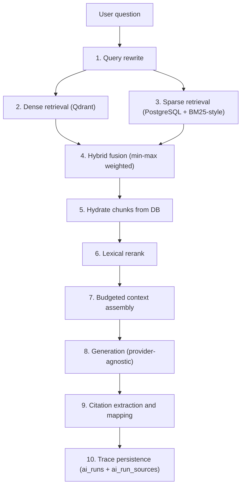

# RAG pipeline

The retrieval-augmented generation pipeline turns a question into a grounded,
cited answer. It is implemented across `app/ai/rag/` (chunker, embedding,
retriever, pipeline) and driven by `app/services/ai_services.py`.

The pipeline is deliberately transparent: every stage is recorded on the
`ai_runs` row so the UI can show which query variants were used, how many
candidates each leg returned, which chunks made it into the context window, and
which citation number maps to which document/chunk.

## 1. The ten stages



| # | Stage | Where |
|---|---|---|
| 1 | Query rewrite into 2–3 retrieval variants | `RAGPipeline._rewrite_query` |
| 2 | Dense retrieval over Qdrant | `Retriever.retrieve` |
| 3 | Sparse retrieval via `ILIKE` + BM25-style scorer | `Retriever._sparse_search` |
| 4 | Hybrid fusion with `HYBRID_ALPHA` | `Retriever._fuse` |
| 5 | Hydrate chunk text + document metadata from PostgreSQL | `Retriever._hydrate` |
| 6 | Lexical rerank | `Retriever._rerank` |
| 7 | Numbered, budgeted context assembly | `RAGPipeline._assemble_context` |
| 8 | Answer generation | `RAGPipeline.answer` → provider `chat` |
| 9 | Citation marker extraction and mapping | `RAGPipeline.answer` |
| 10 | Trace persistence | `RunRecorder` |

### 1. Query rewrite

The `query_rewrite` prompt asks the model for 2–3 retrieval-friendly variants in
JSON (`{"queries": [...]}`). The original question is always inserted first. If
rewriting fails for any reason (AI error, unparseable JSON), the stage is skipped
with an `INFO` log and the raw question is used — a rewrite failure is never
fatal. At most three queries are used.

### 2–4. Retrieval

See §3 below.

### 5. Hydration

Fused candidates are ordered by score and the top `max(top_k * 3, top_k)` are
hydrated by joining `document_chunks` to `documents`. A vector hit whose
`chunk_id` no longer exists in the database is a stale point; it is logged
(`stale_vector_point`) and skipped rather than surfacing content that cannot be
cited.

### 6. Rerank

See §4 below.

### 7. Context assembly

Chunks are numbered and packed into a budget of `_CONTEXT_BUDGET_TOKENS = 6000`
tokens. Each chunk is truncated to fit (`truncate_for_prompt`), its cost is
estimated as `estimate_tokens(body) + 30`, and assembly stops when the budget is
exhausted (or ≤ 200 tokens remain). The label format is:

```
【资料 {index}】来源：{document_title} ／ {heading}（片段 #{chunk_index}）
{body}
```

Chunks are separated by `\n\n---\n\n`.

### 8. Generation

The `rag_answer` prompt is rendered with `context`, `question` and `history`
(the last four history turns, each truncated to 300 characters) and sent as a
system message with the question as the user message. `temperature` is
`AI_TEMPERATURE` (0.2) and `max_tokens` is `AI_MAX_TOKENS` (8192).

The prompt's hard rules (from `builtin.py`): use only the supplied fragments; put
a `[n]` marker after each conclusion; if the material is insufficient, say so and
name what is missing; answer in Chinese.

### 9. Citation extraction and grounding

`_CITATION = re.compile(r"\[(\d{1,2})\]")` finds markers in the answer.
`analyse_citations(answer, len(used))` splits the answer at sentence/paragraph
boundaries into claim-bearing units (anything shorter than 8 characters is a fragment,
not a claim) and returns a `CitationReport`:

| Field | Meaning |
|---|---|
| `valid_citation_ids` | markers that resolve to a real retrieved source |
| `invalid_citation_ids` | markers outside `1..len(used)` |
| `claim_units` / `supported_units` | units, and units carrying at least one valid marker |
| `coverage` | `supported_units / claim_units` |
| `grounded` | true only when every unit is supported, there is at least one valid marker, and no marker dangles |
| `reason` | why `grounded` is false, in words |

**What `grounded` does and does not mean.** It is a *structural* check: the answer
attributes every claim to a source it was given. It is **not** fact-level entailment —
this pipeline does not verify that source 3 actually supports sentence 3, and nothing here
should be read as claiming that.

If the answer is not grounded, the pipeline retries **once** with the citation
requirement restated (skipped for the deterministic offline engine, which cannot change
its own output). If the retry is still ungrounded, the answer is returned with an explicit
`⚠️ 未验证` note naming the reason, and `grounded=false` — it is never marked verified
just because a source list was appended.

Three things that used to be one field are now separate in the API response:
`retrieved_sources` (what the search returned and the model was shown),
`used_citation_ids` (what the text actually refers to), and `grounded` (what the program
established). Every retrieved chunk that made it into the context is also returned as a
citation object `{index, document_id, document_title, chunk_id, chunk_index, heading,
score, snippet}` and persisted to `ai_run_sources`.

### 10. Trace persistence

`recorder.set_retrieval(retrieval_meta, len(used))` and
`recorder.add_sources(...)` write the retrieval metadata and sources; `finish()`
writes status, tokens, latency and cost.

## 2. Chunking strategy

`app/ai/rag/chunker.py` is a heading-aware recursive chunker. Rationale, from the
module docstring:

1. **Structure first.** Markdown headings split the document into semantic
   sections *before* any size-based splitting, so a chunk never mixes two
   unrelated topics.
2. **Sentence-boundary splits.** Within a section, whole sentences are packed
   until the target size is reached; a sentence is never cut in half.
3. **Overlap.** Consecutive chunks share `overlap` characters to preserve context
   across boundaries.
4. **Heading breadcrumb.** Every chunk is prefixed with its heading path
   (e.g. `JVM 学习笔记 > 垃圾回收`), which improves embedding quality and makes the
   citation readable.

Algorithm (`chunk_text(text, chunk_size=900, overlap=150)`):

* Split into sections with a heading stack; each section keeps its breadcrumb
  path.
* Clamp `overlap` to `chunk_size // 2`.
* A section shorter than `chunk_size` is kept whole (splitting hurts retrieval).
* Longer sections are packed sentence-by-sentence with the overlap window carried
  into the next chunk. A single sentence longer than `2 * chunk_size` is
  hard-split at `chunk_size - overlap` steps.
* A "runt" piece shorter than `_MIN_CHUNK_CHARS` (120) is merged into the previous
  chunk of the same section.
* The final `content` is `"{breadcrumb}\n{body}"` (the breadcrumb is embedded with
  the text); `heading` holds the breadcrumb separately.

`TextChunk` exposes `index`, `content`, `heading`, `char_count` and
`token_estimate` (computed in `__post_init__`).

The behaviour is covered by `backend/tests/unit/test_chunker.py` (sequential
indices, breadcrumb prefix, size respected with the documented 2× slack for an
oversized sentence, overlap preserved, empty input, invalid size, overlap clamp,
token estimates, oversized-sentence splitting).

## 3. Hybrid retrieval

`app/ai/rag/retriever.py`. The design goal is a hybrid that works on a stock
PostgreSQL install with no Chinese tokeniser.

### Dense leg

* Embed the query (`EmbeddingService.embed_query`).
* Ensure the Qdrant collection exists for that dimension, then search with
  `limit = candidate_k` (`RETRIEVAL_CANDIDATE_K`, default 40).
* Filter by `knowledge_base_ids` and/or `document_ids` so a search can never leak
  across tenants.
* A `VectorStoreError` is caught: the pipeline logs
  `dense_retrieval_unavailable` and degrades to keyword-only. In `semantic` mode
  the error is re-raised, because there is no fallback leg to serve.

### Sparse leg

* `_salient_terms(query)` tokenises the query and keeps up to 8 unique terms,
  longest-first (more specific terms make better SQL candidates).
* Candidate generation uses `DocumentChunk.content ILIKE '%term%'` with
  `%`, `_` and `\` escaped (`_escape_like`), joined to `documents`, filtered to
  `status = COMPLETED` and `embedding_status != SKIPPED`, limited to
  `candidate_k * 4`.
* **Why `ILIKE` instead of `to_tsvector`:** PostgreSQL ships no Chinese tokeniser
  by default and this project must work out of the box on a stock install.
* Candidates are then scored in-process with an Okapi BM25-style formula
  (`k1 = 1.5`, `b = 0.75`):

```
idf(t)  = ln(1 + (N - df(t) + 0.5) / (df(t) + 0.5))
score   = Σ_t idf(t) * (tf(t) * (k1 + 1)) / (tf(t) + k1 * (1 - b + b * len/avg_len))
```

### Fusion

`_fuse(dense, sparse, alpha)`:

* If only one leg has results, that leg is returned unchanged.
* Otherwise both legs are min-max normalised (`(v - lo) / (hi - lo)`; a flat
  distribution maps to 1.0).
* The fused score is the weighted sum:

```
score = alpha * dense_norm + (1 - alpha) * sparse_norm
```

where `alpha = HYBRID_ALPHA` (default **0.6**, i.e. the dense leg dominates).

The per-leg scores are preserved on every result (`vector_score`, `keyword_score`)
so the UI can explain *why* a chunk matched. In `semantic` mode only the dense leg
is used; in `keyword` mode only the sparse leg.

### Ranking window

The fused results are sorted and truncated to `max(top_k * 3, top_k)` before
hydration, then to `top_k` after reranking. `top_k` defaults to
`RETRIEVAL_TOP_K` (8).

## 4. Reranker

`Retriever._rerank(query, chunks)` is a **lexical** reranker (no cross-encoder
model is shipped — that would require a large model download). All features are
computed against the original query:

| Feature | Weight | Definition |
|---|---|---|
| Query-term coverage | 0.45 | `|query_terms ∩ body_terms| / |query_terms|` |
| Exact phrase hit | 0.25 | 1.0 if any lower-cased query bigram appears in the body |
| Heading match | 0.20 | term coverage against the chunk heading |
| Length prior | 0.10 | 1.0 if `200 ≤ len(content) ≤ 1600`, else 0.6 |

```
lexical = 0.45*coverage + 0.25*phrase + 0.20*heading_match + 0.10*length_prior
score   = round(0.65 * fused_score + 0.35 * lexical, 6)
```

The fused score stays dominant so a strong semantic match that shares no literal
terms is never discarded; the lexical features reorder near-ties. Reranking is
skipped when `RERANK_ENABLED=false` or when the query yields no terms.

## 5. Failure modes and degradation

| Failure | Behaviour | Where |
|---|---|---|
| Qdrant unreachable (hybrid) | Log `dense_retrieval_unavailable`, continue keyword-only | `Retriever.retrieve` |
| Qdrant unreachable (semantic) | Re-raise `VectorStoreError` (no fallback leg) | `Retriever.retrieve` |
| Query rewrite fails | Log `query_rewrite_skipped`, use the raw question | `RAGPipeline._rewrite_query` |
| No chunks retrieved | Return a "no relevant material" answer with `grounded=false`; the run is still `SUCCEEDED` | `RAGPipeline.answer` |
| Stale vector point (no DB row) | Log `stale_vector_point`, skip the chunk | `Retriever._hydrate` |
| Model returns no `[n]` markers | Append a source list; report `grounded=false` | `RAGPipeline.answer` |
| Model returns invalid JSON (rewrite) | Fall back to the raw question | `load_json_object` |
| Model returns invalid JSON (analysis/plan) | Raise `AIResponseFormatError` | `load_json_object` |
| Embedding provider error | Batch marked `FAILED` with the error text; if *all* batches fail the document is `FAILED` | `DocumentService.ingest` |
| Redis down | Search results are recomputed (no cache); request still succeeds | `core/cache.py` |
| No embedding provider configured | Offline hashed n-gram embedder (dimension 384) | provider factory |

## 6. Tuning knobs

All are environment variables (see `.env.example`); defaults are from
`app/core/config.py`.

| Variable | Default | Effect |
|---|---|---|
| `CHUNK_SIZE` | 900 | Target chunk size in characters |
| `CHUNK_OVERLAP` | 150 | Overlap between consecutive chunks (clamped to half the chunk size) |
| `RETRIEVAL_TOP_K` | 8 | Chunks returned after reranking |
| `RETRIEVAL_CANDIDATE_K` | 40 | Candidates per leg before fusion |
| `HYBRID_ALPHA` | 0.6 | Weight of the dense leg in fusion |
| `RERANK_ENABLED` | true | Enable the lexical reranker |
| `EMBEDDING_MODEL` | text-embedding-3-small | Embedding model (also keys the embedding cache) |
| `EMBEDDING_BATCH_SIZE` | 16 | Batch size for embedding calls |
| `QDRANT_VECTOR_SIZE` | 0 | 0 = detect from the first embedding and create on demand |
| `QDRANT_DISTANCE` | Cosine | Collection distance metric |
| `CACHE_TTL_SEARCH_SECONDS` | 180 | Search-result cache TTL |

Context budget (`_CONTEXT_BUDGET_TOKENS = 6000` tokens) and the reranker weights
are constants in code, not configuration.

## 7. Embedding service

`app/ai/rag/embedding.py`:

* Batches pending texts (batch size = `min(64, len(pending))`).
* **Content-hash caching**: the cache key is
  `make_key("embed", model, content_hash(text, model))` where `content_hash` is
  `sha256(model + \x00 + text)[:32]`. Identical text is never embedded twice — the
  single biggest cost saver when a document is re-processed. TTL is 24 h.
* A mismatched number of returned vectors raises `AIError`.
* Dimension discovery: if the provider reports dimension 0, the service calls an
  optional `set_dimension()` on it so the Qdrant collection can be created on
  demand.
* Logs `embedding_completed` with text count, cache hits, embedded count,
  dimension and model.

## 8. Vector store

`app/infrastructure/vector_store.py` wraps `AsyncQdrantClient`:

* Collection is created lazily with the **actual** embedding dimension, so
  switching between a 1536-dim cloud model and a 384-dim offline embedder needs no
  code change. HNSW is configured with `m=16`, `ef_construct=128`.
* If the collection exists with a different dimension, a `VectorStoreError` is
  raised naming both dimensions and the fix: stop the stack, remove
  `.runtime/qdrant/storage`, start it again so the collection is recreated at the
  new size, then re-queue the vectors with
  `python -m app.cli reindex --knowledge-base <id>`. There is no `--drop` switch —
  `reindex` only queues a job, it never deletes anything.
* Payload indexes on `knowledge_base_id`, `document_id`, `owner_id` (KEYWORD).
* Payload schema per point: `chunk_id`, `document_id`, `knowledge_base_id`,
  `owner_id`, `chunk_index`, `heading`, `document_title`, `content` (first 1200
  chars), `embedding_model`.
* Delete helpers: `delete_points`, `delete_by_document`, `delete_by_knowledge_base`.

## 9. The retrieval ladder (four tiers, cheapest first)

`app/ai/rag/tiers.py` is not one of the ten stages above — it decides **whether the
pipeline runs at all**. A question a stored fact, a known procedure or a document in
the user's own library can answer never reaches the reasoning path. That, and not a
faster model, is where "faster than a general assistant" comes from.

| # | Tier | Judged by |
|---|---|---|
| 1 | `memory` | term overlap ≥ `MIN_TERM_OVERLAP` (1) against the user's memory entries |
| 2 | `skill` | `find_matching_skills` over the installed skills (`when_to_use`) |
| 3 | `knowledge` | hybrid retrieval, top chunk's combined relevance ≥ `RELEVANCE_FLOOR` |
| 4 | `general` | always hits — reasoning, tools, possibly the network |

`resolve()` walks them in order and **stops at the first hit**. Stopping early *is*
the optimisation: asking all four every time would make the measurement meaningless.

Tier 3's floor is measured rather than chosen. `RELEVANCE_FLOOR = 1.693` was
calibrated by `scripts/sample_relevance.py`, which samples two populations — eight
questions the library genuinely covers, six plausible ones it does not — and prints
every candidate signal for both. The score that survived is
`max(vector_score / 0.15, keyword_score / 2.0)`: both terms are *absolute*, and the
two earlier attempts failed precisely because their signal was normalised against
the returned set, so its top value stayed high whether or not anything matched. The
margin is 0.14 on fourteen samples — narrow, and stated rather than smoothed over.
**If the corpus or the embedding model changes, re-measure before trusting it.**

Two rules the tiers enforce rather than merely document:

* **A miss is reported as a miss.** Tier 4 is not a fallback pretending the first
  three were never asked: the result carries every attempt and what each said. A
  retrieval that *failed* is reported as `检索失败：<error>`, never as "no material"
  — "I could not look" and "I have nothing" are different answers.
* **Tier 2 distinguishes "not built" from "nothing matched".** `SKILL_LAYER_BUILT`
  exists so that an empty list cannot mean two things at once.

`scripts/measure_tiers.py` times each tier; `scripts/sample_relevance.py` measures
the floor. The measured milliseconds, the two failed threshold attempts and the
per-tier reasoning are in [../RETRIEVAL.md](../RETRIEVAL.md) (Chinese).

## 10. Related documents

* [ai.md](ai.md) — providers, prompts, tracing
* [database.md](database.md) — `document_chunks`, `ai_run_sources`
* [../RETRIEVAL.md](../RETRIEVAL.md) — the retrieval ladder in full: timings, the two
  failed thresholds, and how "did it answer?" is decided
* [../docs/thesis/07-AI模块设计.md](thesis/07-AI模块设计.md) — the Chinese design chapter

---

*Checked against the source at `c6bad76` (2026-10-07): the ten stages, the chunker
parameters, the hybrid retrieval weights and ranking window, the reranker, the
degradation paths, the embedding service and the vector-store schema were each compared
with the implementation. Three corrections came out of it: `AI_MAX_TOKENS` is 8192, the
`reindex --drop` flag this document told you to use does not exist, and the four-tier
retrieval ladder was not documented at all. The rest of the document was compared item
by item and matched.*
