# 第二章 需求分析

## 2.1 需求分析概述

本章从用户角色出发，通过用例分析提炼功能需求与非功能需求，为后续设计提供依据。需求分析遵循两条原则：一是**以闭环为主线**，即所有功能都应服务于"资料 → 知识 → 任务 → 执行 → 结果 → 知识"这一主链路；二是**以可验证为准绳**，每一条需求都对应系统中可检查的端点、数据表或行为。

## 2.2 用户角色

本系统采用单用户（single-tenant）模型，不设组织与团队概念，但通过 `owner_id` 对所有数据做归属隔离。角色划分如下：

| 角色 | 说明 | 主要操作 |
|---|---|---|
| 普通用户 | 系统的唯一使用者，拥有自己的全部数据 | 管理项目与知识库、上传文档、检索与问答、管理任务与笔记、使用规划器与 Agent、查看执行轨迹 |
| 系统（AI） | 以工具调用形式参与执行的自动化角色 | 通过 11 个注册工具读取知识、生成计划、创建任务与笔记、建立知识关联 |
| 运维者 | 部署与运行系统的人 | 启动基础设施、启动应用、查看健康与指标、排障 |

普通用户与 AI 的关系不是"用户命令 AI"的单向关系，而是**协作关系**：用户设定目标，AI 依据知识库资料产出计划与结果，用户再对结果进行确认与调整。

## 2.3 用例分析

### 2.3.1 用例图

```mermaid
flowchart TB
    U(["普通用户"])
    AI(["AI 系统"])
    OPS(["运维者"])

    subgraph SYS["AI Workbench"]
        UC1["注册 / 登录"]
        UC2["管理项目"]
        UC3["管理知识库"]
        UC4["上传并解析文档"]
        UC5["关键词 / 语义 / 混合检索"]
        UC6["知识库问答（带引用）"]
        UC7["AI 分析文档（摘要/概念/待办/卡片）"]
        UC8["生成任务计划"]
        UC9["管理任务树与依赖"]
        UC10["管理笔记"]
        UC11["运行工具调用 Agent"]
        UC12["查看 AI 执行轨迹与指标"]
        UC13["管理提示词版本"]
        UC14["查看仪表盘与关系图谱"]
        UC15["健康检查与指标"]
    end

    U --> UC1
    U --> UC2
    U --> UC3
    U --> UC4
    U --> UC5
    U --> UC6
    U --> UC7
    U --> UC8
    U --> UC9
    U --> UC10
    U --> UC11
    U --> UC12
    U --> UC13
    U --> UC14
    AI --> UC11
    AI --> UC8
    AI --> UC10
    OPS --> UC15
```

### 2.3.2 主要用例描述

#### 用例 UC04：上传并解析文档

| 项 | 内容 |
|---|---|
| 参与者 | 普通用户 |
| 前置条件 | 已登录，且存在至少一个知识库 |
| 触发 | 用户选择文件并提交上传 |
| 主流程 | 1. 系统校验扩展名与 Content-Type；2. 流式保存文件并计算 SHA-256；3. 若同一知识库内已存在相同内容哈希，判定为重复并直接返回；4. 否则创建 `documents` 记录（状态 `PENDING`）并写入 `jobs` 任务；5. 返回 202 与任务编号 |
| 后台流程 | 6. Worker 领取任务；7. 解析文件为纯文本；8. 按标题分块；9. 批量向量化并写入 Qdrant；10. 更新文档状态为 `COMPLETED` |
| 后置条件 | 文档可分块检索；每个分块有对应向量 |
| 异常 | 扩展名不支持（415）；文件超过 25 MB（413）；解析失败或分块为空（文档置 `FAILED` 并记录原因） |
| 相关需求 | FR-04、FR-05、NFR-02、NFR-05 |

#### 用例 UC06：知识库问答

| 项 | 内容 |
|---|---|
| 参与者 | 普通用户 |
| 前置条件 | 已登录，且知识库中有 `COMPLETED` 状态的文档 |
| 触发 | 用户输入问题 |
| 主流程 | 1. 查询改写为 2–3 条检索变体；2. 对每条变体做混合检索；3. 合并去重并取最高分；4. 词法重排；5. 预算化装配带编号的上下文；6. 调用模型生成；7. 抽取 `[n]` 引用标记并映射到来源；8. 记录 AI 执行轨迹 |
| 后置条件 | 返回带引用列表的答案；`ai_runs` 与 `ai_run_sources` 有对应记录 |
| 异常 | 知识库不存在（404）；检索不到内容时返回"未检索到资料"的诚实答复且标记 `grounded=false` |
| 相关需求 | FR-06、FR-07、NFR-06 |

#### 用例 UC11：运行工具调用 Agent

| 项 | 内容 |
|---|---|
| 参与者 | 普通用户、AI 系统 |
| 前置条件 | 已登录，已配置知识库（可选项目） |
| 触发 | 用户提交目标 |
| 主流程 | 1. 注入实时工具目录构造系统提示词；2. 模型给出下一步动作；3. 每步至多执行一个工具；4. 将观察结果回填并继续；5. 直到给出最终答复、达到步数上限或检测到重复调用 |
| 后置条件 | 产生真实的 `tasks` / `notes` 等实体；`agent_runs`、`tool_calls` 记录完整轨迹 |
| 异常 | 目标为空（422）；写操作超过上限（工具返回失败并记录）；重复调用（主动终止并记录 `loop_detected`） |
| 相关需求 | FR-09、FR-10、NFR-04 |

## 2.4 功能需求

功能需求按模块编号，`FR` 表示 Functional Requirement。

### 2.4.1 认证与用户

| 编号 | 需求 | 说明 |
|---|---|---|
| FR-01 | 用户注册 | 邮箱、用户名、口令；口令不少于 8 位且须包含字母与数字；邮箱与用户名唯一 |
| FR-02 | 用户登录 | 支持用户名或邮箱作为标识；错误凭据统一返回"用户名或口令错误" |
| FR-03 | 个人信息 | 查询与更新显示名、头像颜色 |

### 2.4.2 项目与知识库

| 编号 | 需求 | 说明 |
|---|---|---|
| FR-04 | 项目 CRUD | 名称、描述、图标、颜色、状态；同一用户下项目名唯一 |
| FR-05 | 知识库 CRUD | 名称、描述、图标、颜色、所属项目、归档；同一用户下名称唯一；删除时级联删除文档与分块并清理向量 |

### 2.4.3 文档摄取

| 编号 | 需求 | 说明 |
|---|---|---|
| FR-06 | 文档上传 | 支持 `.md`/`.markdown`/`.txt`/`.pdf`；单文件不超过 25 MB；返回 202 |
| FR-07 | 重复检测 | 同一知识库内相同内容哈希视为重复，不重复处理 |
| FR-08 | 摄取进度 | 提供状态、进度百分比、当前阶段、错误信息与嵌入进度 |
| FR-09 | 重新处理 | 支持对文档重新入队摄取 |
| FR-10 | 文档删除 | 删除文档、分块、向量与本地文件 |
| FR-11 | 文档分析 | 支持摘要、概念、待办、术语、学习计划、面试题、笔记、知识卡片八类动作 |

### 2.4.4 检索与问答

| 编号 | 需求 | 说明 |
|---|---|---|
| FR-12 | 三种检索模式 | 关键词、语义、混合；混合模式须返回两路分数 |
| FR-13 | 检索缓存 | 相同查询在短时间内命中缓存 |
| FR-14 | RAG 问答 | 返回答案、引用列表、检索元数据、执行编号 |
| FR-15 | 引用约束 | 引用必须指向真实分块；无有效引用时标记 `grounded=false` |

### 2.4.5 任务与笔记

| 编号 | 需求 | 说明 |
|---|---|---|
| FR-16 | 任务 CRUD | 标题、描述、完成标准、优先级、状态、估算工时、截止时间 |
| FR-17 | 任务树 | 目标 → 阶段 → 任务 → 子任务，最多 4 层 |
| FR-18 | 任务依赖 | 支持依赖关系，禁止自依赖与环路 |
| FR-19 | 状态机 | 非法状态迁移返回 409 |
| FR-20 | 知识关联 | 任务可关联文档，形成知识—任务闭环 |
| FR-21 | 笔记管理 | 支持手工笔记与 AI 生成笔记 |

### 2.4.6 AI 能力

| 编号 | 需求 | 说明 |
|---|---|---|
| FR-22 | 任务规划 | 目标 → 阶段 → 任务，含工作量估算与可验证完成标准 |
| FR-23 | 计划落地 | 将生成的计划持久化为真实任务树 |
| FR-24 | Agent 执行 | 受步数与写操作上限约束的工具调用循环 |
| FR-25 | 工具目录 | 对外暴露工具的名称、描述、参数与是否写操作 |
| FR-26 | 执行轨迹 | 记录提示词名称与版本、来源、工具调用、Token、时延、重试与错误 |
| FR-27 | 提示词版本管理 | 列出、创建版本、激活版本、重置为内置模板 |
| FR-28 | AI 指标 | 按时间窗口聚合执行次数、失败率、平均时延、Token 与估算成本 |

### 2.4.7 洞察与运维

| 编号 | 需求 | 说明 |
|---|---|---|
| FR-29 | 仪表盘 | 任务、知识、AI、工作区统计与最近活动 |
| FR-30 | 关系图谱 | 项目/知识库/文档/概念/任务/笔记/AI 执行的节点与边 |
| FR-31 | 健康检查 | 存活探针与依赖就绪探针 |
| FR-32 | 应用指标 | 24 小时 AI 统计与缓存统计 |

## 2.5 非功能需求

| 编号 | 类别 | 需求 | 实现约束 |
|---|---|---|---|
| NFR-01 | 性能 | 上传接口快速返回，不在请求内做重活 | 摄取在后台 Worker 执行；上传仅校验、落盘、入队 |
| NFR-02 | 性能 | 检索有缓存，避免重复计算 | Redis 缓存检索结果，TTL 180 秒，按命名空间版本失效 |
| NFR-03 | 可用性 | 任一外部依赖故障不应导致请求失败 | 缓存、向量库故障均降级并记录告警 |
| NFR-04 | 可靠性 | 后台任务不丢失、可重试、可恢复 | 数据库队列 + 有界重试 + 指数退避 + 陈旧任务恢复 + 任务级超时 |
| NFR-05 | 安全 | 上传安全、认证安全、注入防护、日志脱敏 | 白名单、MIME 校验、流式限额、UUID 文件名、存储根包含性检查、JWT+bcrypt、参数化 SQL、密钥脱敏 |
| NFR-06 | 可追溯 | 每次 AI 执行可完整回放 | `ai_runs` + `tool_calls` + `ai_run_sources` + `agent_runs` |
| NFR-07 | 可移植 | 不依赖 Docker 即可运行 | 原生 Windows 二进制运行于 `vendor/runtime`，项目级进程 |
| NFR-08 | 可配置 | 切换模型后端无需改代码 | 全部配置来自 `.env`，Provider 工厂统一构建 |
| NFR-09 | 离线可用 | 无密钥、无本地模型时系统仍完整可用 | 确定性离线引擎兜底，并如实标注 `degraded` |
| NFR-10 | 可维护 | 分层清晰、错误分类、无吞异常 | 单向依赖分层、类型化异常、集中异常处理 |
| NFR-11 | 一致性 | 删除操作行为明确 | 外键级联 + 服务层显式清理向量与文件 |
| NFR-12 | 可观测 | 请求与 AI 执行可关联 | `request_id` / `run_id` 上下文变量、结构化日志、响应头 |

## 2.6 数据需求

系统需要持久化 22 类实体，分为五个域：

| 域 | 实体 |
|---|---|
| 用户域 | 用户 |
| 工作区域 | 项目、笔记、活动事件 |
| 知识域 | 知识库、文档、文档分块、标签、文档标签、概念、文档概念 |
| 任务域 | 任务、任务依赖、任务标签、任务文档 |
| AI 域 | 提示词、提示词版本、AI 执行、Agent 执行、工具调用、AI 执行来源、后台任务 |

数据需求的关键约束：

* 所有业务实体通过 `owner_id` 归属到用户，实现数据隔离；
* 文档在同一知识库内以 `(knowledge_base_id, content_hash)` 唯一，用于重复检测；
* 分块在文档内以 `(document_id, chunk_index)` 唯一；
* 提示词版本在提示词内以 `(prompt_id, version)` 唯一；
* 任务依赖对 `(task_id, depends_on_task_id)` 唯一。

## 2.7 运行环境需求

| 项 | 要求 |
|---|---|
| 操作系统 | Windows 10/11（本项目验证环境） |
| 运行时 | Python 3.11 及以上（验证环境为 3.13.14） |
| 数据库 | PostgreSQL 16（验证环境 16.4） |
| 缓存 | Redis 5（验证环境 5.0.14.1） |
| 向量库 | Qdrant 1.12（验证环境 1.12.4） |
| 浏览器/客户端 | 任意支持 HTTP 的客户端；API 文档页 `/docs` |

## 2.8 本章小结

本章从用户角色与用例出发，梳理了 32 条功能需求与 12 条非功能需求，并明确了数据需求与运行环境需求。功能需求围绕"知识—任务—执行"闭环组织，非功能需求则强调了性能、可用性、可靠性、安全、可追溯、可移植与离线可用。这些需求是后续总体设计与详细设计的直接输入。
