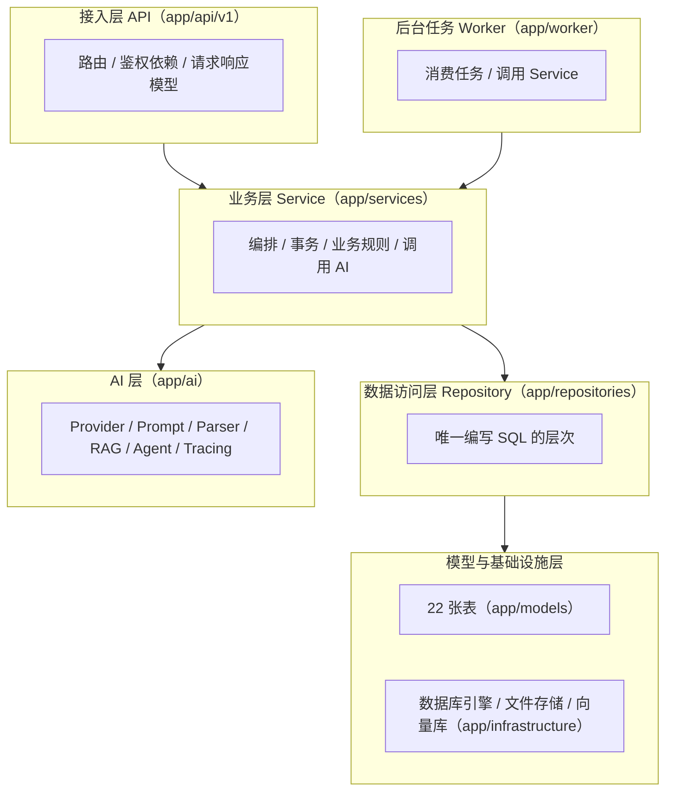
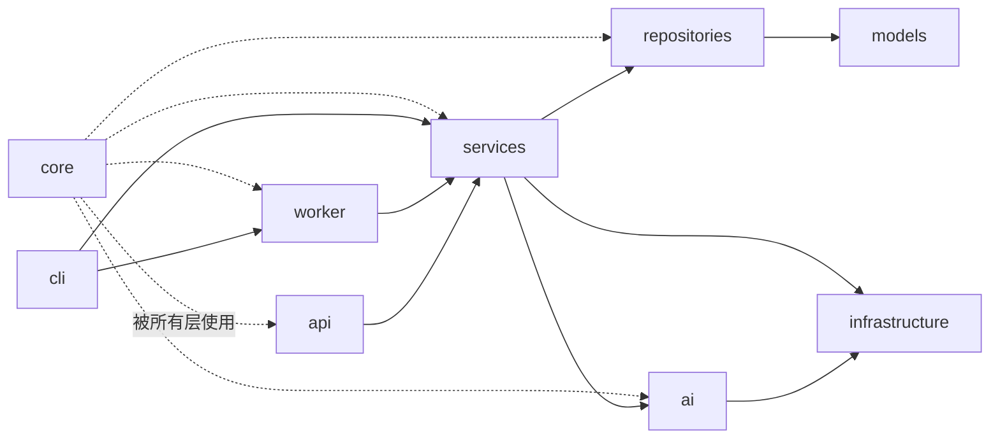
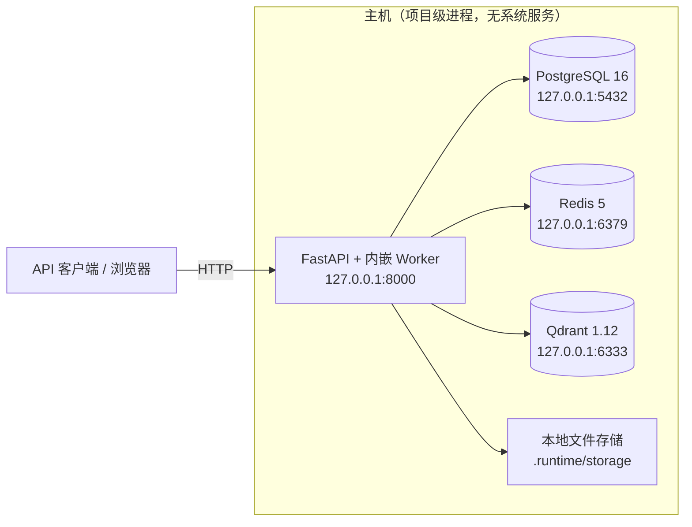
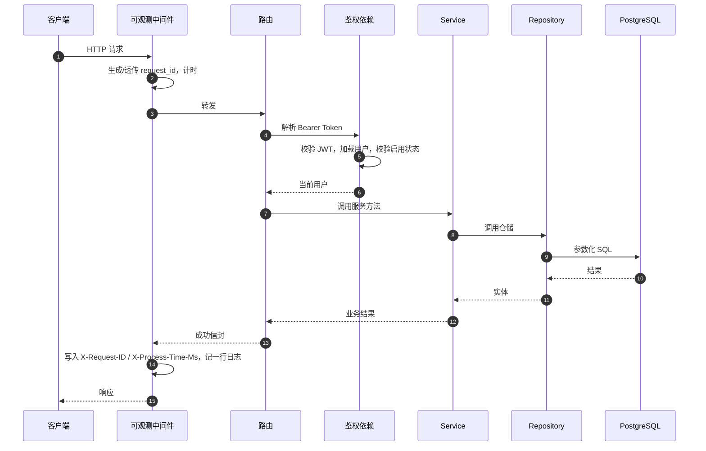
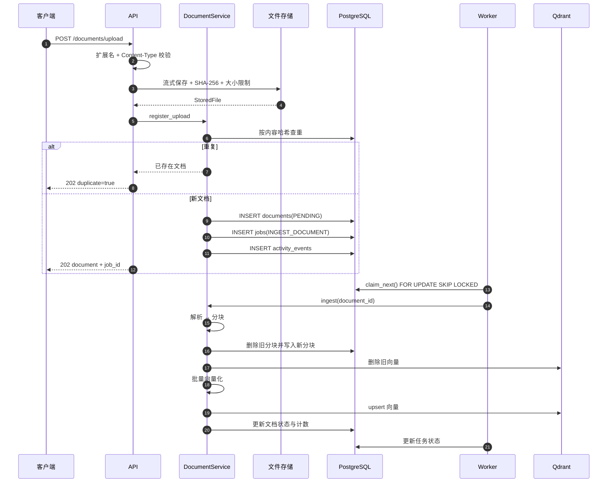
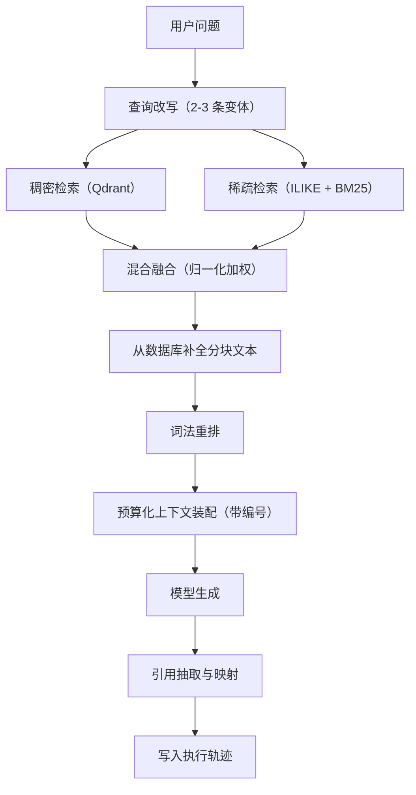
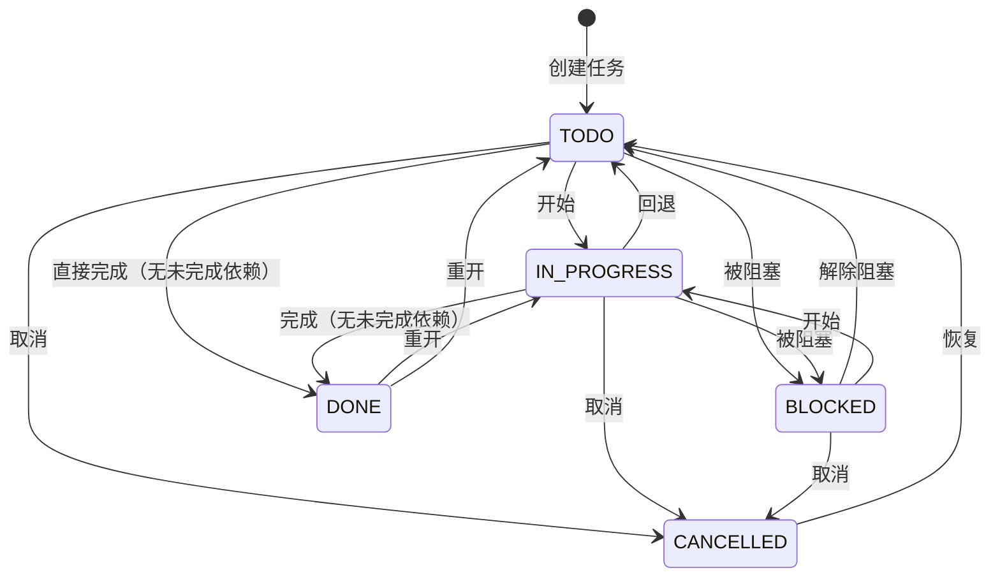
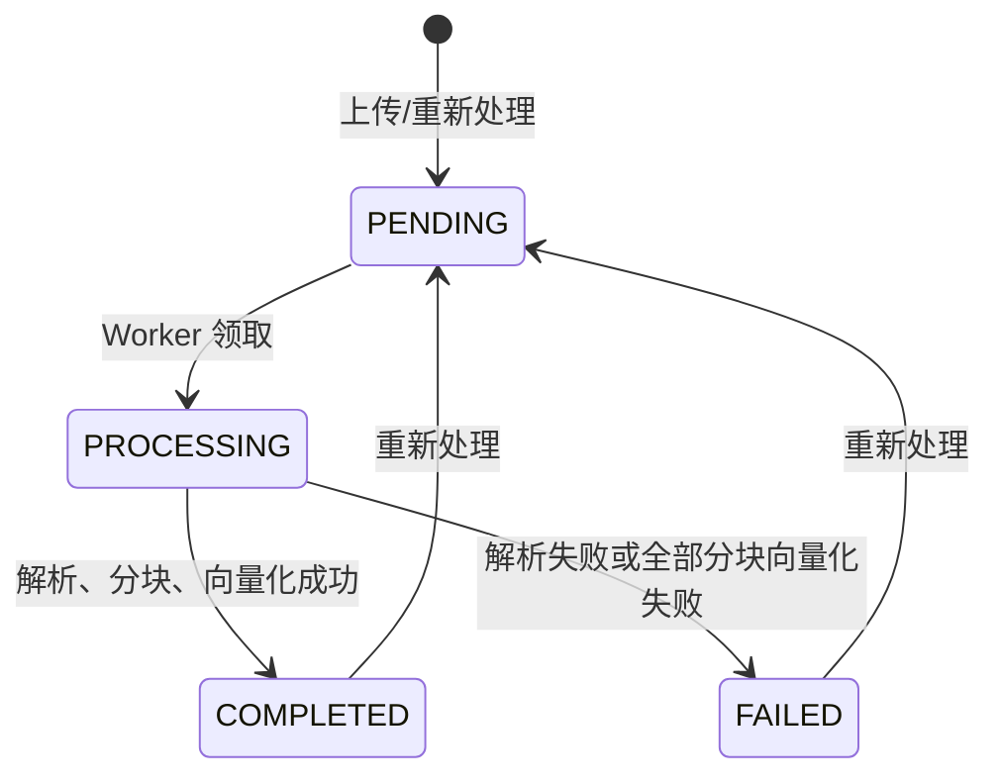
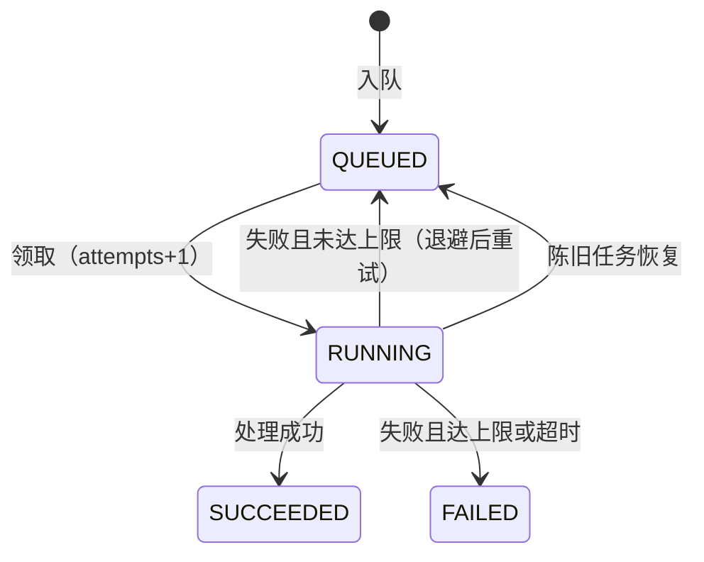
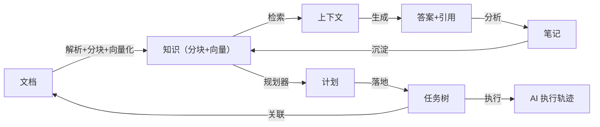

# 第四章 系统总体设计

## 4.1 设计目标与原则

系统总体设计围绕第二章确定的闭环主线展开，遵循以下原则：

1. **闭环优先**：所有模块都服务于"资料 → 知识 → 任务 → 执行 → 结果 → 知识"这一主链路，避免出现孤立功能。
2. **分层解耦**：采用单向依赖分层，使各层可独立理解、测试与替换。
3. **故障降级**：外部依赖（缓存、向量库、模型）故障时降级而非中断，并如实记录。
4. **可追溯**：任何一次 AI 执行都可回放，任何一条答案都可溯源到分块。
5. **配置驱动**：模型后端、检索参数、缓存策略等通过配置切换，不改代码。
6. **本地优先**：无密钥、无本地模型时系统仍完整可用。

## 4.2 总体架构

### 4.2.1 分层架构

系统采用五层结构，依赖方向严格自上而下：

分层规则（在代码审查与类型检查中约束）：

* 接入层不写业务规则、不写 SQL；
* 业务层不写原始 SQL，除仪表盘与关系图谱这类**只读投影**可在归属服务内直接构造查询外，其余均通过仓储；
* 仓储层是唯一编写 SQL 的层次；
* **Agent 不直接访问数据库**，只能调用工具，工具调用服务，服务调用仓储；
* 异常必须类型化，禁止吞异常。

### 4.2.2 模块划分

| 模块 | 职责 | 主要文件 |
|---|---|---|
| 核心基础设施 | 配置、日志、错误、安全、重试、缓存、日期、响应封装 | `app/core/*` |
| 领域枚举 | 全系统共享的枚举定义 | `app/domain/enums.py` |
| 数据模型 | 22 张表 | `app/models/*` |
| 数据访问 | 通用仓储与领域仓储 | `app/repositories/*` |
| 业务服务 | 认证、工作区、任务、文档、AI、统计 | `app/services/*` |
| AI 层 | Provider、提示词、解析、RAG、Agent、追踪 | `app/ai/*` |
| 后台任务 | 数据库队列与处理器 | `app/worker/runner.py` |
| 接入层 | 路由与依赖 | `app/api/*` |
| 命令行 | 服务、Worker、种子、检查、统计、重建索引 | `app/cli.py` |

### 4.2.3 模块依赖关系

`core` 是被所有层使用的横切模块，但不反向依赖任何业务模块。

## 4.3 部署拓扑

### 4.3.1 进程拓扑

设计说明：

* **基础设施以原生二进制运行。** 开发机不具备 Docker 环境（Docker Desktop 缺失且镜像仓库不可达），因此 PostgreSQL、Redis、Qdrant 以原生 Windows 二进制下载到 `vendor/runtime/`，由 `scripts/infra-start.ps1` 以项目级进程启动。所有数据文件、日志、PID 均位于仓库内。
* **Worker 默认内嵌于 API 进程。** 通过 `WORKER_ENABLED=true` 在 FastAPI 的 `lifespan` 中启动，便于单机演示；也可通过 `python -m app.cli worker` 独立运行。
* **单节点部署。** 本设计面向单机；多节点部署需要额外处理向量库与文件存储的共享问题，属于后续工作。

### 4.3.2 容器化说明

仓库**包含** `docker-compose.yml` 以及 `backend/Dockerfile`、`frontend/Dockerfile`、
`worker/Dockerfile`，定义了 postgres / redis / qdrant / api / frontend 五个服务
（worker 为可选 profile）。但开发机不具备 Docker 环境（Docker Desktop 缺失且
`registry-1.docker.io` 不可达），因此**容器化路径未在本机构建或启动过**。
该文件顶部已明确标注这一限制，`FINAL_CHECKLIST.md` 中对应两项记为 N/A 而非 PASS。
本机实际验证的是 4.3.1 描述的原生进程方案。

## 4.4 请求生命周期设计

要点：

* `request_id` 通过上下文变量贯穿 API、Service、AI 与 Worker，实现跨层关联；
* 成功统一返回 `{"success": true, "data": ...}`，失败统一返回 `{"success": false, "error": {...}, "request_id": ...}`；
* 每请求记录一行结构化日志，状态码 ≥ 400 时以告警级别记录。

## 4.5 关键流程设计

### 4.5.1 文档摄取流程

摄取被拆分为"请求内轻量注册"与"后台重量处理"两段，保证上传接口快速返回。

摄取阶段：`PARSING → CHUNKING → EMBEDDING → COMPLETED`；任一步失败则文档置 `FAILED` 并写入可读原因。

### 4.5.2 RAG 问答流程

十个阶段的详细设计见第七章。

### 4.5.3 任务执行流程

非法迁移返回 409；存在未完成依赖时不可完成；依赖形成环路时拒绝添加。

### 4.5.4 文档状态机

### 4.5.5 后台任务状态机

## 4.6 数据流设计

### 4.6.1 数据流向

这条数据流对应"资料 → 知识 → 任务 → 执行 → 结果 → 知识"的闭环：文档成为知识，知识驱动任务，任务执行产生结果，结果沉淀为笔记并再次成为知识，任务又可反向关联文档。

### 4.6.2 关键数据关系

* 文档通过 `task_documents` 与任务建立"知识—任务"边；
* AI 执行通过 `ai_run_sources` 记录引用了哪些分块与文档；
* 笔记通过 `source_document_id` 与 `source_run_id` 记录来源文档与来源执行；
* 关系图谱是上述外键与连接表的直接投影，节点类型为 `project | knowledge_base | document | concept | task | note | ai_run`，边类型为 `contains | mentions | subtask_of | uses_knowledge | produced | retrieved`。

## 4.7 可靠性设计

| 设计点 | 方案 |
|---|---|
| 任务不丢失 | 任务行与业务数据在同一事务中提交 |
| 并发安全领取 | `SELECT ... FOR UPDATE SKIP LOCKED` |
| 有界重试 | 最大尝试次数 + 指数退避（`min(300, 5·2^(n-1))` 秒） |
| 陈旧任务恢复 | Worker 启动时回收超时的 `RUNNING` 任务 |
| 任务级超时 | `asyncio.timeout(WORKER_JOB_TIMEOUT_SECONDS)` |
| 事件循环饥饿防护 | 无可领取任务时必定让出事件循环（详见第六章与第八章） |
| 缓存降级 | 缓存故障降级为无缓存，记录一次告警 |
| 向量库降级 | 混合模式下降级为关键词检索 |
| 幂等初始化 | 建表、种子、角色与数据库创建均带存在性判断 |

## 4.8 安全设计概览

| 层面 | 措施 |
|---|---|
| 上传 | 扩展名白名单、MIME 一致性、流式限额、UUID 文件名、存储根包含性检查、空文件拒绝 |
| 认证 | bcrypt（cost 12）、JWT HS256、登录时序安全、禁用账户拒绝 |
| 授权 | 全端点鉴权、`get_owned` 归属校验、检索前校验知识库归属 |
| 输入 | Pydantic 全量校验、枚举校验、业务规则以 409 表达 |
| 注入 | 参数化 SQL、LIKE 通配符转义、AST 受限的算术求值器 |
| 日志 | 密钥脱敏、敏感键清洗、保留键守卫、数据库 URL 口令脱敏 |
| 跨域 | CORS 显式白名单 |

## 4.9 本章小结

本章给出了系统的总体设计：五层架构与模块划分、进程拓扑与部署方式、请求生命周期、文档摄取与 RAG 问答的关键流程、任务与文档与后台任务的状态机、数据流向、可靠性与安全设计。总体设计确定了"分层解耦、故障降级、可追溯、配置驱动、本地优先"的骨架，为后续数据库设计与详细设计奠定基础。
