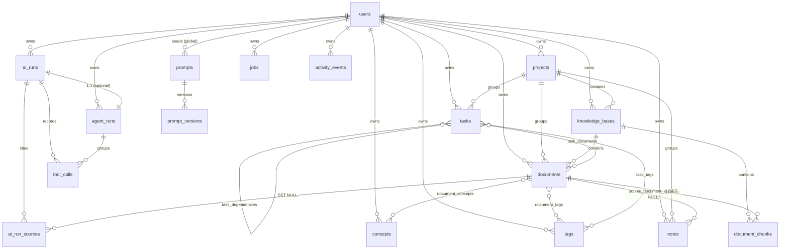
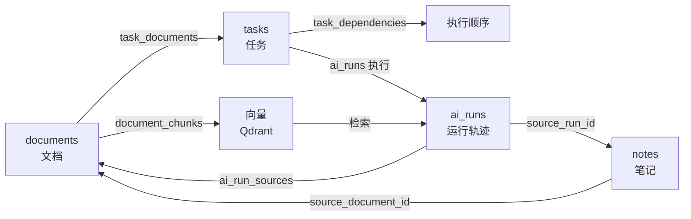

# 第五章 数据库设计

本章描述 AI Workbench 的数据模型。系统的全部持久化结构由
`backend/app/models/` 下的 SQLAlchemy 2.0 声明式模型定义，共 **7 个模块、22 张表**。
本章中的表名、列名、类型、约束与索引均与源码逐一对应，读者可打开对应模型文件核对。

## 5.1 数据库选型与总体策略

系统采用 **PostgreSQL 16** 作为唯一的关系型持久化存储，另以 **Qdrant 1.12**
存放向量、**Redis 5** 承担缓存与轻量协调。选择 PostgreSQL 的理由如下：

| 需求 | PostgreSQL 的能力 |
|---|---|
| 结构化实体与复杂外键关系 | 完整的事务与外键约束，支持级联删除语义 |
| 半结构化 AI 载荷（检索元数据、工具参数、运行轨迹） | 原生 `JSONB` 类型，可索引、可查询 |
| 并发任务队列 | 支持 `SELECT ... FOR UPDATE SKIP LOCKED`，无需引入消息中间件 |
| 时序型统计查询 | `timestamptz` 与组合索引，满足仪表盘聚合 |
| 全文/模糊候选 | `ILIKE` 与 GIN 索引，作为混合检索的稀疏腿数据源 |

向量检索不在 PostgreSQL 内实现，而是交给专用的 Qdrant，二者通过
`documents` / `document_chunks` 表中的 `vector_id` 字段建立一一映射。这种"关系
库存元数据、向量库存向量"的分工，使关系型事务与向量近邻搜索各自使用最合适的引擎。

> 设计取向：**先保证可追溯，再追求性能**。系统的核心循环是
> "资料 → 知识 → 任务 → 执行 → 结果 → 再沉淀为知识"，因此每一次 AI 调用、
> 每一条引用、每一个工具调用都必须落库，使任何一次回答都能回溯到它的输入证据。

## 5.2 命名规范与通用约定

统一约定定义在 `app/models/base.py`，目的是让约束名可预测、可迁移。

### 5.2.1 主键

所有业务实体使用 **UUID v4** 主键，由 `UUIDPrimaryKeyMixin` 提供：

```python
id: Mapped[uuid.UUID] = mapped_column(
    Uuid(as_uuid=True), primary_key=True, default=uuid.uuid4
)
```

选择 UUID 而非自增整数的原因：系统面向本地多用户与未来的数据导出/合并场景，
UUID 不暴露记录数量、不依赖数据库序列、可离线生成。纯关联表
（`document_tags`、`task_tags`、`task_documents` 等）改用**复合主键**，避免无意义的
代理键。

### 5.2.2 时间戳

`TimestampMixin` 统一提供两个列：

| 列 | 类型 | 约束 |
|---|---|---|
| `created_at` | `DateTime(timezone=True)` | `NOT NULL`，`server_default=func.now()`，建索引 |
| `updated_at` | `DateTime(timezone=True)` | `NOT NULL`，`server_default=func.now()`，`onupdate=func.now()` |

使用带时区的 `timestamptz` 而非本地时间，避免部署环境时区差异导致排序错乱。
并非所有表都带时间戳：`document_chunks`、`prompt_versions` 等只增不改的表
使用 `UUIDPrimaryKeyMixin`，不引入 `updated_at`。

### 5.2.3 `eager_defaults`

声明式基类设置 `eager_defaults = True`。这一项在异步引擎下至关重要：服务端生成的
列（如 `created_at`）在 flush 后通常处于"过期"状态，Pydantic 序列化时会触发惰性
加载，而在 asyncpg 驱动下会抛出 `MissingGreenlet`。开启 `eager_defaults` 后，
SQLAlchemy 通过 `RETURNING`（PostgreSQL 原生支持）在同一条 INSERT/UPDATE 中
取回这些值，刚 flush 的行即可安全序列化。

> 该配置对应一次真实缺陷修复，详见第 9.4 节"真实缺陷清单"中的缺陷 D3。

### 5.2.4 约束命名约定

`Base.metadata` 配置了确定性命名模板：

```
ix_%(table_name)s_%(column_0_N_name)s
uq_%(table_name)s_%(column_0_N_name)s
ck_%(table_name)s_%(constraint_name)s
fk_%(table_name)s_%(column_0_name)s_%(referred_table_name)s
pk_%(table_name)s
```

确定性命名使 `alembic revision --autogenerate` 生成的迁移脚本稳定可复现，
也为后续的迁移演进预留了基础（当前仓库快照未提交迁移文件，见 5.9 节）。

### 5.2.5 JSONB 的使用边界

`JSONB` 仅用于**结构不固定或整体读写的载荷**，例如 `ai_runs.request_payload`、
`tool_calls.arguments`、`jobs.payload`。凡需要按列过滤、排序或建立外键的字段，
一律使用独立的关系列。这避免了"把关系模型塞进 JSON"导致查询能力退化。

## 5.3 表清单

按业务域将 22 张表分组如下：

| 序号 | 表名 | 模型类 | 所属模块 | 业务域 |
|---|---|---|---|---|
| 1 | `users` | `User` | `user.py` | 身份 |
| 2 | `projects` | `Project` | `project.py` | 工作区 |
| 3 | `knowledge_bases` | `KnowledgeBase` | `knowledge.py` | 知识 |
| 4 | `documents` | `Document` | `knowledge.py` | 知识 |
| 5 | `document_chunks` | `DocumentChunk` | `knowledge.py` | 知识 |
| 6 | `tags` | `Tag` | `knowledge.py` | 知识 |
| 7 | `document_tags` | `DocumentTag` | `knowledge.py` | 知识（关联） |
| 8 | `concepts` | `Concept` | `knowledge.py` | 知识 |
| 9 | `document_concepts` | `DocumentConcept` | `knowledge.py` | 知识（关联） |
| 10 | `tasks` | `Task` | `task.py` | 任务 |
| 11 | `task_dependencies` | `TaskDependency` | `task.py` | 任务（关联） |
| 12 | `task_tags` | `TaskTag` | `task.py` | 任务（关联） |
| 13 | `task_documents` | `TaskDocument` | `task.py` | 任务↔知识（关联） |
| 14 | `notes` | `Note` | `note.py` | 沉淀 |
| 15 | `prompts` | `Prompt` | `ai.py` | AI 治理 |
| 16 | `prompt_versions` | `PromptVersion` | `ai.py` | AI 治理 |
| 17 | `ai_runs` | `AIRun` | `ai.py` | AI 运行 |
| 18 | `agent_runs` | `AgentRun` | `ai.py` | AI 运行 |
| 19 | `tool_calls` | `ToolCall` | `ai.py` | AI 运行 |
| 20 | `ai_run_sources` | `AIRunSource` | `ai.py` | AI 运行 |
| 21 | `jobs` | `Job` | `job.py` | 任务队列 |
| 22 | `activity_events` | `ActivityEvent` | `job.py` | 审计/动态 |

## 5.4 实体关系图



图中 `||--o{` 表示一对多，`}o--o{` 表示多对多（经关联表），`||--||` 表示一对一。

## 5.5 核心表结构说明

### 5.5.1 知识域

**`knowledge_bases`** 是知识的容器，核心列包括 `name`、`description`、
`embedding_model`、`vector_size`、`is_archived`。唯一约束
`uq_knowledge_bases_owner_id_name` 保证同一用户下知识库名称唯一。其
`project_id` 为 `SET NULL`，即项目被删除时知识库保留并变为"未归属"。

**`documents`** 是最复杂的业务表，承载文档全生命周期。关键列：

| 列 | 作用 |
|---|---|
| `content_hash` | SHA-256 十六进制，配合唯一约束 `uq_documents_kb_content_hash` 做去重 |
| `status` | 摄取状态（`PENDING`/`PROCESSING`/`READY`/`FAILED`） |
| `progress` | 0–100 的进度，供前端轮询展示 |
| `chunk_count` / `embedded_chunk_count` | 分块总数与已嵌入数，是"知识化"完成度的度量 |
| `page_count` / `language` | PDF 页数与语言探测结果 |
| `doc_metadata` | 映射自列名 `metadata`（避开 SQLAlchemy 保留名），`JSONB` |
| `stored_path` | 文件在本地存储根下的相对路径 |

去重的作用域限定在**同一知识库内**（`knowledge_base_id + content_hash`），
因此同一份资料可以同时存在于不同知识库而互不干扰。

**`document_chunks`** 是检索的最小单元。除 `content` 外，另存
`heading`（所属标题）、`token_estimate`（估算 token 数）、`vector_id`
（与 Qdrant 点 ID 一一对应）、`embedding_status`。分块是"只增不改"的：
重新摄取时旧块整批删除、重新创建，因此该表没有 `updated_at`。

**`concepts`** 与 **`document_concepts`** 构成概念图谱。`concepts` 使用
`normalized_name`（归一化名称）配合唯一约束 `uq_concepts_owner_id_normalized_name`
避免同义重复；`document_concepts` 额外携带 `weight`（概念在文档中的权重），
使图谱可以按重要度排序。

### 5.5.2 任务域

**`tasks`** 支持树形结构：`parent_id` 自引用外键（`ON DELETE CASCADE`），
配合 `depth`（嵌套层级）与 `position`（同级排序）。`source` 区分任务来源
（`MANUAL` 人工 / `PLANNER` 规划生成 / `AGENT` 智能体创建），`ai_suggestion`
保存 AI 给出的建议文本，`completion_criteria` 记录完成标准。

**`task_dependencies`** 表达任务间依赖，唯一约束
`uq_task_dependencies_pair` 保证同一依赖对只存在一次。**环路检测在服务层完成**
（`TaskService._creates_cycle`，深度优先遍历），而非由数据库约束实现——这是
一个有意识的取舍：数据库难以表达"无环"约束，交给应用层更简单可靠。

**`task_documents`** 是"知识↔任务"的边，携带 `relevance`（相关度）。正是这张表
把知识闭环中的"任务"与"知识"连接起来。

### 5.5.3 AI 运行域

**`ai_runs`** 是系统的审计中枢，一张表承载一次 AI 运行的完整轨迹：

| 分组 | 列 |
|---|---|
| 标识 | `run_id`（`run_` + 20 位十六进制，唯一）、`parent_run_id`、`run_type` |
| 关联 | `owner_id`、`project_id`、`knowledge_base_id` |
| 模型 | `provider`、`model`、`prompt_name`、`prompt_version` |
| 输入输出 | `request_payload`、`result_payload`、`response_text` |
| 检索 | `retrieval_meta`、`retrieval_count` |
| 工具 | `tools_used`、`tool_call_count` |
| 计费 | `prompt_tokens`、`completion_tokens`、`total_tokens`、`cost_estimate` |
| 性能 | `latency_ms`、`retry_count` |
| 错误 | `error_code`、`error_message` |
| 时间 | `created_at`、`finished_at` |

`ai_runs` 是审计轨迹，**不会被隐式删除**，只有随用户级联删除才会消失。

**`agent_runs`** 与 `ai_runs` 是可选的一对一关系（`ai_run_id` 唯一）。它记录
智能体目标 `goal`、`max_steps`（默认 8）、`steps_used`、`plan`、`scratchpad`
（推理草稿）、`final_answer`，以及 `created_entity_ids`（本次运行创建了哪些实体，
用于可撤销/可追溯）。

**`tool_calls`** 记录每一次工具调用的 `step_index`、`tool_name`、`arguments`、
`result`、`status`、`error_message`、`latency_ms`。索引
`ix_tool_calls_ai_run_step` 支撑按运行、按步骤的顺序读取。

**`ai_run_sources`** 记录引用的**具体分块**：`document_id`、`chunk_id`、
`document_title`、`chunk_index`、`score`、`snippet`。注意 `document_id` 与
`chunk_id` 均为 `SET NULL`——即使源文档被删除，引用的标题与片段文本仍然保留，
**溯源信息不因删除而丢失**。这是可追溯性设计的关键决策。

### 5.5.4 队列与审计域

**`jobs`** 是数据库驱动的任务队列。核心列 `status`、`priority`（越小越优先）、
`attempts` / `max_attempts`、`scheduled_at`（认领要求 `<= now()`）、
`locked_by`（worker 标识）、`stage`。索引 `ix_jobs_status_scheduled`
是 `SKIP LOCKED` 认领查询的支撑索引。

**`activity_events`** 记录用户可见的动态流：`event_type`、`entity_type`、
`entity_id`、`title`、`event_metadata`，配合索引
`ix_activity_events_owner_created` 支撑时间线分页。

## 5.6 级联删除行为

级联行为是数据一致性的关键，下表是权威总结。

| 删除对象 | 效果 |
|---|---|
| `users` 行 | 级联删除其项目、知识库、文档、分块、标签、概念、任务、笔记、AI 运行（及工具调用/引用/智能体运行）、任务、动态事件 |
| `projects` 行 | 级联删除其 `knowledge_bases`（并传递删除文档与分块）；`tasks`、`documents`、`notes` **不删除**，其 `project_id` 置为 `NULL` |
| `knowledge_bases` 行 | 级联删除其文档与分块；服务层先调用 `VectorStore.delete_by_knowledge_base()`，向量库失败仅记录日志、不阻断删除 |
| `documents` 行 | 级联删除分块、标签关联、概念关联、任务关联；`ai_run_sources.document_id` 与 `notes.source_document_id` 置 `NULL`（引用文本保留） |
| `tasks` 行 | 级联删除子任务、依赖、标签关联、文档关联 |
| `ai_runs` 行 | 级联删除工具调用、引用、智能体运行 |
| `prompts` 行 | 级联删除其版本 |

除数据库级联外，服务层还执行 SQL 无法表达的副作用：删除文档/知识库时清理 Qdrant
点；删除文档时删除本地文件（`delete_file` 会拒绝存储根之外的路径）。

## 5.7 知识闭环的数据表达

系统的核心循环在数据层可清晰表达：



- **文档 → 知识**：文档的分块被嵌入并写入 Qdrant，即完成"知识化"。
- **知识 → 任务**：通过 `task_documents` 建立任务与知识库文档的关联。
- **任务 → 执行**：一次执行产生一条 `ai_runs` 记录。
- **执行 → 引用**：`ai_run_sources` 精确记录回答引用了哪些分块，使溯源可查询。
- **结果 → 知识**：笔记可携带 `source_document_id` 与 `source_run_id`，
  把产出重新沉淀回知识库，闭环成立。

仪表盘的关系统图（`GraphService.build`）正是这些外键的直接投影：节点类型为
`project | knowledge_base | document | concept | task | note | ai_run`，
边类型为 `contains | mentions | subtask_of | uses_knowledge | produced | retrieved`。

## 5.8 索引设计

除逐列 `index=True` 外，系统建立了下列组合索引（节选，完整表见
`docs/database.md` 第 7 节）：

| 索引 | 表 | 列 | 服务的查询 |
|---|---|---|---|
| `ix_projects_owner_status` | projects | owner_id, status | 按用户列出活跃项目 |
| `uq_documents_kb_content_hash` | documents | knowledge_base_id, content_hash | 库内去重 |
| `ix_documents_kb_status` | documents | knowledge_base_id, status | 按状态过滤文档 |
| `ix_tasks_owner_status` | tasks | owner_id, status | 任务看板 |
| `ix_tasks_project_status` | tasks | project_id, status | 项目内任务 |
| `ix_ai_runs_owner_created` | ai_runs | owner_id, created_at | 运行历史时间线 |
| `ix_jobs_status_scheduled` | jobs | status, scheduled_at | 队列认领 |
| `ix_tool_calls_ai_run_step` | tool_calls | ai_run_id, step_index | 轨迹回放 |

索引设计遵循"以查询驱动"的原则：每个组合索引都对应一条真实的列表或过滤查询，
没有为假想的访问模式预建索引。

Qdrant 侧为集合创建了三个 `KEYWORD` 载荷索引：`knowledge_base_id`、
`document_id`、`owner_id`，用于检索时按库、按文档、按用户过滤。

## 5.9 模式管理现状与局限

当前模式的创建方式如下：

- 启动时 `app/main.py:_bootstrap_schema` 检查现有表名，对缺失的表调用
  `Base.metadata.create_all`。该过程幂等，使全新克隆无需迁移步骤即可运行。
- Alembic 是声明依赖（`alembic>=1.13,<2.0`），且命名约定确定，具备采用
  `autogenerate` 的基础；但**本仓库快照未提交任何迁移文件**
  （`backend/alembic/versions/` 为空）。

由此带来的局限必须如实说明：

1. `create_all` **只能建表，不能改表**。字段类型变更、列删除、约束调整都不会被
   自动应用，需要手工迁移或重建库。
2. 当前模式**未版本化**，无法回答"线上库对应哪个代码版本"。
3. 缺少迁移文件意味着团队协作中模式演进依赖人工同步，存在漂移风险。

这些局限已列入第 10 章的"不足与后续工作"。

## 5.10 测试对模式定义的持续校验

`backend/tests/conftest.py` 为测试创建独立的 `aiworkbench_test` 数据库，会话级执行
一次 `drop_all` + `create_all`，并在每个测试之间用
`TRUNCATE ... RESTART IDENTITY CASCADE` 清空所有表。这一机制保证模式定义在每次
测试运行时都被实际执行一次，任何模型定义错误都会立即暴露。第 9 章描述的冒烟测试
同样在真实 PostgreSQL 上运行，间接验证了外键、唯一约束与级联删除的正确性。

## 5.11 本章小结

本章给出 AI Workbench 的完整数据模型：22 张表按身份、工作区、知识、任务、沉淀、
AI 治理与运行、队列与审计七个业务域组织；以 UUID 主键、`timestamptz` 时间戳、
`JSONB` 载荷与确定性命名约定为统一规范；通过精心的外键级联策略在删除与溯源之间
取得平衡（尤其是 `ai_run_sources` 的 `SET NULL` 保留引用文本）；并以索引设计
支撑真实的查询负载。知识闭环"资料 → 知识 → 任务 → 执行 → 结果 → 再沉淀为知识"
在数据层得到完整表达。模式管理当前依赖 `create_all`、缺少迁移版本化，是明确的
工程局限，将在后续工作中补齐。
