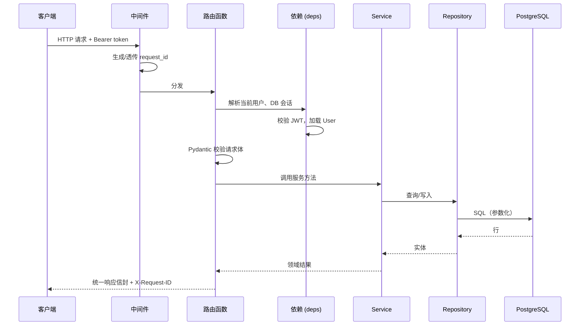
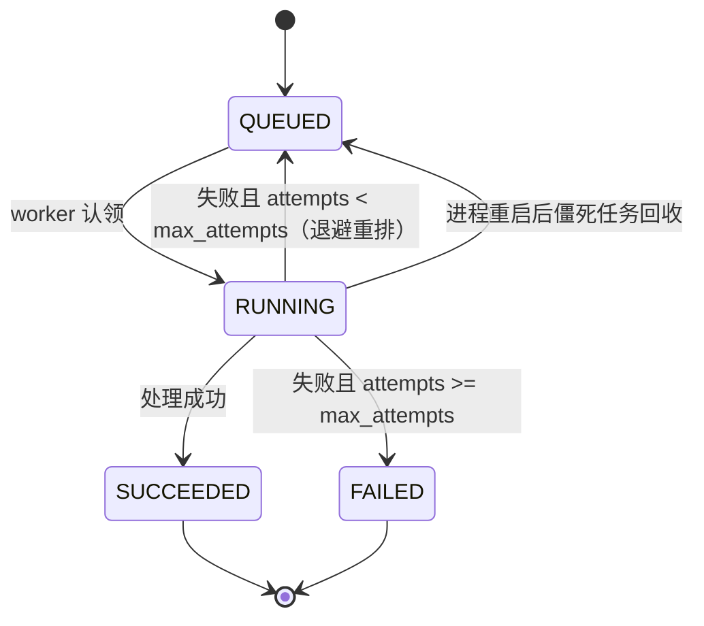
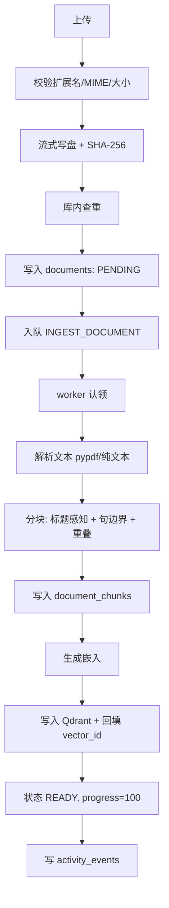
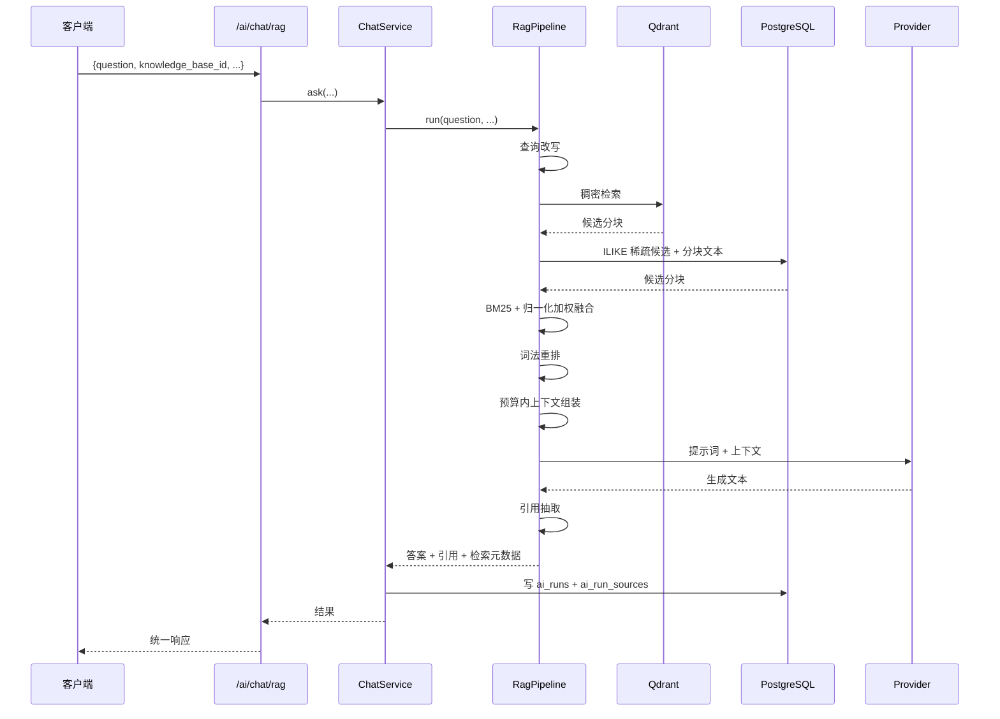

# 第六章 详细设计

第 4 章给出了系统的总体架构与分层原则，本章深入到每一层的内部设计：接口层的
路由组织与请求处理、服务层的业务编排、仓储层的查询抽象、基础设施层的资源封装，
以及贯穿其中的错误处理、事务与异步设计。本章所涉类名、方法名与路由均与源码一致。

## 6.1 后端代码组织

后端源码位于 `backend/app/`，按职责划分为以下包：

| 包 | 职责 | 关键文件 |
|---|---|---|
| `core/` | 配置、日志、错误、安全、缓存、重试、日期、响应 | `config.py`、`errors.py`、`security.py`、`cache.py` |
| `domain/` | 与框架无关的枚举与领域常量 | `enums.py` |
| `models/` | SQLAlchemy 声明式模型（22 张表） | `user.py`、`knowledge.py`、`task.py`、`ai.py`、`job.py` |
| `repositories/` | 数据访问，封装查询 | `base.py`、`knowledge_repo.py`、`work_repo.py`、`ai_repo.py` |
| `services/` | 业务编排，事务边界 | `auth_service.py`、`document_service.py`、`ai_services.py` |
| `ai/` | AI 能力：provider、RAG、agent、prompts、解析 | `providers/`、`rag/`、`agent/` |
| `infrastructure/` | 外部资源封装：数据库、文件、向量库 | `database.py`、`files.py`、`vector_store.py` |
| `api/v1/` | HTTP 接口 | `auth.py`、`projects.py`、`knowledge.py`、`tasks.py`、`ai.py`、`insights.py`、`health.py` |
| `worker/` | 数据库驱动的后台任务执行器 | `runner.py` |

依赖方向自上而下：`api → services → repositories → models/infrastructure`，
`services` 可调用 `ai/`，`ai/` 只依赖 `core/` 与 `infrastructure/`。
**`ai/` 不直接访问数据库**——所有持久化都经 `services` 与 `repositories` 完成，
这保证了 AI 层可在测试中用内存替身替换。

## 6.2 接口层设计

### 6.2.1 路由组织

所有路由在 `app/api/v1/__init__.py` 中聚合为一个 `api_router`，再由
`app/main.py` 以 `settings.api_v1_prefix`（默认 `/api/v1`）挂载。各模块的路由器
及前缀如下：

| 路由器 | 前缀 | 标签 | 主要职责 |
|---|---|---|---|
| `health_router` | 无 | health | 存活、就绪、指标 |
| `auth_router` | `/auth` | auth | 注册、登录 |
| `user_router` | 无 | users | `/users/me` 资料读写 |
| `projects_router` | `/projects` | projects | 项目 CRUD |
| `knowledge_router` | `/knowledge-bases` | knowledge | 知识库 CRUD、标签 |
| `documents_router` | `/documents` | documents | 文档上传、摄取、分块、内容 |
| `search_router` | `/search` | search | 关键词/语义/混合检索 |
| `tasks_router` | `/tasks` | tasks | 任务 CRUD、树、依赖、知识关联 |
| `notes_router` | `/notes` | notes | 笔记 CRUD |
| `ai_router` | 无 | ai | RAG 问答、规划、智能体、提示词 |
| `airuns_router` | `/ai-runs` | ai-runs | 运行历史、指标、轨迹 |
| `insights_router` | 无 | insights | `/stats/dashboard`、`/graph` |

**健康检查路由有意不加认证**，以便编排系统（orchestrator）可直接探测。

### 6.2.2 请求处理流程

一个典型请求（如 `POST /documents`）的处理链路如下：

### 6.2.3 依赖注入

`app/api/deps.py` 提供可复用的依赖：数据库会话、当前用户、分页参数等。会话依赖
使用 `async with session_factory()` 的生命周期，确保请求结束即释放连接。当前用户
依赖解码 JWT、校验 `is_active`，并返回 `User` 实体；所有需要鉴权的路由通过
`Depends(get_current_user)` 获取它，实现**默认安全**——忘记加依赖的路由才需要
显式说明为何公开。

### 6.2.4 统一响应与错误

响应经 `core/response.py` 统一封装；错误由 `core/errors.py` 定义的异常族表达，
并由全局异常处理器转换为一致的 JSON 结构（含 `code`、`message`、可选 `details`）。
领域异常（如 `NotFoundError`、`ConflictError`、`ValidationError`）在服务层抛出，
处理器映射为对应 HTTP 状态码。这样服务层无需感知 HTTP，接口层无需重复 try/except。

## 6.3 服务层设计

服务层是业务编排与**事务边界**所在。会话的提交由服务方法控制，仓储只负责查询
构造，不自行提交。主要服务如下。

### 6.3.1 `AuthService`

职责：注册、密码校验、令牌签发。注册时用 bcrypt（cost 12）哈希密码，用户名与
邮箱做唯一性校验（依赖数据库唯一约束并捕获冲突转成领域异常）。登录校验成功后
签发 HS256 JWT。

### 6.3.2 `ProjectService` / `KnowledgeService` / `NoteService`（`workspace_service.py`）

这三个服务管理"工作区"资源。它们的共同模式是：先校验归属（当前用户是否拥有该
实体），再执行操作。列表查询支持过滤（如按 `status`、`project_id`）与分页。
删除操作在数据库级联之外执行副作用：删除知识库前调用
`VectorStore.delete_by_knowledge_base()`；删除文档时删除本地文件。

### 6.3.3 `DocumentService`（`document_service.py`）

文档服务是知识域的核心，负责：

1. **上传接收**：校验扩展名白名单、MIME 一致性、流式写入并限制大小，文件名以
   UUID 存储以避免路径穿越；计算 SHA-256，在同一知识库内查重。
2. **创建记录**：写入 `documents` 行（`status=PENDING`），并入队一个
   `INGEST_DOCUMENT` 任务。
3. **状态查询**：返回摄取进度（`progress`、`chunk_count`、
   `embedded_chunk_count`）。
4. **重处理**：删除旧分块与向量后重新入队。
5. **删除**：删除数据库记录、向量与文件。

### 6.3.4 `TaskService`（`task_service.py`）

任务服务实现任务树、依赖与知识关联：

- 创建/更新任务时维护 `parent_id`、`depth`、`position`；
- `complete` 设置 `status=COMPLETED` 与 `completed_at`；
- 添加依赖前调用 `_creates_cycle(task_id, candidate_dependency)` 做深度优先环路
  检测，若成环则拒绝；
- `link_knowledge` / `unlink_knowledge` 维护 `task_documents`。

### 6.3.5 `StatsService` / `GraphService`（`stats_service.py`）

`StatsService` 聚合仪表盘数据（文档数、任务完成率、AI 调用统计等），所有数值
**直接来自数据库聚合查询**，不做任何硬编码或估算。`GraphService.build` 把外键
关系投影为节点与边，供前端绘制关系统图。

### 6.3.6 `SearchService` / `ChatService` / `PlannerService` / `AgentService` / `AIRunService`（`ai_services.py`）

| 服务 | 方法 | 职责 |
|---|---|---|
| `SearchService` | `search` | 关键词/语义/混合检索，委托 RAG 检索器 |
| `ChatService` | `ask` | RAG 问答：检索 + 生成 + 引用提取，写 `ai_runs` |
| `PlannerService` | `generate_plan` / `persist_plan` | 生成并落库分阶段任务树 |
| `AgentService` | `run` | 执行工具调用智能体 |
| `AIRunService` | `get_trace` / `metrics` / `daily` / `health` | 运行轨迹、指标、日聚合、健康 |

`ChatService.ask` 与 `AgentService.run` 都通过 `RunRecorder`（`ai/tracing.py`）
创建 `ai_runs` 并记录工具调用、引用与 token 计数，保证每次 AI 调用都可审计。

### 6.3.7 规划结果的归一化

`PlannerService._normalise_plan(raw, goal, horizon_days)` 把模型返回的任意 JSON
归一化为系统认可的结构，并用 `_safe_int` / `_safe_priority` 兜底非法值
（如模型给出 `"priority": "urgent"` 或非整数时长）。这体现了"**不信任模型输出**"
的防御式设计：模型输出先归一化、再校验，才允许落库。

## 6.4 仓储层设计

### 6.4.1 通用仓储与显式模型助手

`repositories/base.py` 提供 `BaseRepository`，其中包含三类通用方法：

| 方法 | 签名 | 用途 |
|---|---|---|
| `list_of` | `list_of(model, *conditions)` | 按条件列出**指定模型** |
| `get_one_of` | `get_one_of(model, *conditions)` | 取指定模型的一条 |
| `count_of` | `count_of(model, *conditions)` | 统计指定模型的行数 |

设计要点：通用查询助手**显式接收 `model` 参数**，而不是使用 `self.model`。
原因是不同仓储的 `self.model` 不同（如 `ProjectRepository.model` 是 `Project`），
若用 `self.model` 搭配"另一张表的条件"，会构造出错误实体类型的查询。这个坑是
一次真实缺陷（缺陷 D4，见第 9.4 节），因此通用助手被设计为强制显式传入模型。
例如 `work_repo.py` 统计项目下的知识库时明确写
`count_of(KnowledgeBase, ...)`，而注释也点明了这一约束。

### 6.4.2 领域仓储

| 仓储 | 覆盖实体 |
|---|---|
| `knowledge_repo.py` | 知识库、文档、分块、标签、概念 |
| `work_repo.py` | 项目、任务、笔记 |
| `ai_repo.py` | 提示词、AI 运行、智能体运行、工具调用、引用 |

仓储方法命名统一为 `get_by_id`、`list_...`、`count_...`、`create`、`delete`，
返回领域实体，供服务层组装响应。

### 6.4.3 软删除与硬删除

系统采用**硬删除**配合数据库级联，而非软删除标志位。这一选择基于本地优先的
定位：数据量可控，级联语义清晰，溯源信息通过 `SET NULL` 单独保留（见 5.6 节）。

## 6.5 基础设施层设计

### 6.5.1 数据库（`infrastructure/database.py`）

封装异步引擎与会话工厂：`create_async_engine` 使用 asyncpg 驱动，`async_sessionmaker`
产出 `AsyncSession`。引擎池参数由配置控制。会话生命周期绑定到请求（依赖注入）。

### 6.5.2 文件存储（`infrastructure/files.py`）

职责：安全地读写本地文件。关键设计：

- **存储根约束**：所有路径在写入/删除前都解析为绝对路径并校验其位于存储根之内，
  拒绝 `..` 等穿越尝试。
- **UUID 存储名**：磁盘文件名使用 UUID（保留扩展名），原始文件名仅存数据库，
  避免特殊字符与重名冲突。
- **流式写入**：分块读取并累计字节数，超过上限立即中止并清理半成品文件。
- **删除**：`delete_file` 同样执行根目录校验。

### 6.5.3 向量库（`infrastructure/vector_store.py`）

封装 Qdrant 客户端：确保集合存在（含向量维度与三个 `KEYWORD` 载荷索引）、
`upsert` 分块向量、`search` 近邻查询、`delete_by_document` 与
`delete_by_knowledge_base`。向量库不可用时抛出可识别异常，由上层降级处理。

### 6.5.4 缓存（`core/cache.py`）

基于 Redis 的缓存封装，特性：

- **命名空间版本号失效**：以命名空间版本为键前缀，失效时递增版本，使旧键自然
  过期，避免逐键删除。
- **降级为无缓存**：Redis 不可用时记录日志并直接穿透到数据源，不使请求失败。

### 6.5.5 重试（`core/retry.py`）

对可重试的外部调用（模型 API、向量库）提供带指数退避的重试装饰器，区分可重试
异常与不可重试异常，避免对 4xx 类错误无谓重试。

## 6.6 后台任务执行器设计

`worker/runner.py` 实现数据库驱动的任务队列消费者。设计要点：

### 6.6.1 认领机制

worker 用 `SELECT ... FOR UPDATE SKIP LOCKED` 认领任务，条件是
`status = 'QUEUED' AND scheduled_at <= now()`，按 `priority` 升序。`SKIP LOCKED`
使多个 worker 可并发认领而互不阻塞，无需外部消息中间件。

### 6.6.2 状态机

### 6.6.3 可靠性与时限

- **有界重试**：`attempts` 达到 `max_attempts`（默认 3）后置 `FAILED`。
- **指数退避**：失败后按退避公式重排 `scheduled_at`。
- **僵死任务回收**：启动时把超时仍处 `RUNNING` 的任务重新置回 `QUEUED`。
- **单任务时限**：每个任务在 `asyncio.timeout` 内执行，超时按失败处理。
- **心跳字段**：`locked_by` 与 `started_at` 记录认领者与开始时间，便于诊断。

### 6.6.4 事件循环饥饿缺陷与修复

运行器主循环曾存在一个真实缺陷：当**所有 worker 槽位都忙**时，主循环
`return` 而没有 `await` 任何可让出控制权的东西，导致事件循环饥饿、进程卡死。
修复方式是确保在无可认领任务时进行异步等待（sleep 让出控制权）。这是本项目在
验证阶段发现并修复的最严重缺陷（缺陷 D1，见第 9.4 节）。

## 6.7 文档摄取流水线

文档从上传到"知识化"的完整链路：

各阶段的细节（解析、分块、嵌入）在第 7 章展开。

## 6.8 横切关注点

### 6.8.1 配置管理（`core/config.py`）

使用 Pydantic Settings 从环境变量加载，集中定义所有配置键，并在启动时校验必填项
与取值域。配置对象的类型化字段避免运行期字符串误用。

### 6.8.2 日志（`core/logging.py`）

结构化日志，结合 `contextvars` 携带 `request_id` 与 `run_id`，使同一请求/同一次
AI 运行的所有日志可串联检索。

### 6.8.3 安全（`core/security.py`）

提供密码哈希（bcrypt cost 12）、JWT 签发/校验（HS256）、令牌过期处理，以及
LIKE 通配符转义等辅助函数。

### 6.8.4 日期（`core/dates.py`）

统一时区处理与时间窗口计算（如指标聚合的 `days` 窗口），避免各处重复实现。

## 6.9 关键时序：RAG 问答

## 6.10 前端设计（范围说明）

前端采用 React 18 + Vite 5 + Tailwind 技术栈，工程位于 `frontend/`，与后端**并行
开发**：共享库（`src/lib/`）、UI 组件（`src/components/ui/`）与状态层
（`src/store/`）已就位，页面级实现持续推进。由于前端与后端由不同工作流并行构建、
且其组件与路由设计随开发演进，**本论文聚焦后端的接口、服务、AI 与数据设计，不
展开前端页面级实现细节**。后端已提供前端所需的全部 REST 接口，接口契约见
`docs/api.md`；前端页面实现列为后续工作（见第 10 章）。

## 6.11 本章小结

本章完成了各层的详细设计：接口层以路由器聚合与依赖注入实现默认安全与统一响应；
服务层作为事务边界编排业务并防御式处理模型输出；仓储层以显式模型的通用查询助手
规避类型混淆；基础设施层封装数据库、文件与向量库并保证安全约束；后台执行器以
`SKIP LOCKED` 认领、有界重试与僵死回收实现可靠消费，并修复了事件循环饥饿缺陷；
文档摄取流水线串联了解析、分块与嵌入；横切关注点（配置、日志、安全、日期）集中
实现。前端作为并行工作流在 `frontend/` 下开发，其页面级设计不在本章范围。
