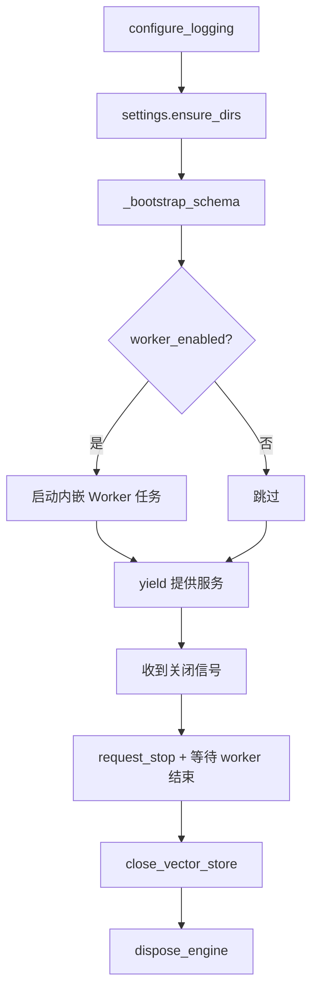

# 第八章 系统实现

本章描述系统的具体实现：开发与运行环境、应用启动流程、关键中间件、文档摄取、
检索、智能体与后台执行器的落地方式，以及实现过程中发现并修复的真实缺陷。所有
数字与类名均取自实际代码库，代码规模统计为对源码的实测结果。

## 8.1 代码规模统计

| 范围 | 文件数 | 行数 |
|---|---|---|
| 后端应用 `backend/app/` | 77 个 `.py` | 13973 |
| 脚本 `scripts/` | 5 个 `.py` | 716 |
| 测试 `backend/tests/` | 14 个 `.py` | 2618 |
| 环境变量样例 `.env.example` | 1 | 52 个配置键 |

后端按 `core / domain / models / repositories / services / ai / infrastructure /
api / worker` 九个包组织。测试包含 4 个单元测试文件与集成测试。

## 8.2 运行环境

| 组件 | 版本 | 获取方式 |
|---|---|---|
| Python | 3.13.14 | 系统安装 |
| FastAPI | 0.142.2 | `pip` |
| SQLAlchemy | 2.0.54 | `pip` |
| qdrant-client | 1.19.1 | `pip` |
| redis (Python 客户端) | 5.3.1 | `pip` |
| pydantic | 2.13.5 | `pip` |
| alembic | 1.20.0 | `pip` |
| pypdf | 5.9.0 | `pip` |
| PostgreSQL | 16.4 | `vendor/runtime/` 本地二进制 |
| Redis | 5.0.14.1 | `vendor/runtime/` 本地二进制 |
| Qdrant | 1.12.4 | `vendor/runtime/` 本地二进制 |

### 8.2.1 关于不使用 Docker 的说明

本项目**在本机刻意不使用 Docker**。原因有二：一是开发环境未安装 Docker Desktop，
二是 Docker Hub 在该网络环境下不可达。取而代之的是把 PostgreSQL、Redis、Qdrant
的可执行文件作为**原生 Windows 二进制**下载到 `vendor/runtime/`，由
`scripts/infra-start.ps1` 启动。

仓库中**同时提供**了 `docker-compose.yml`（postgres / redis / qdrant / api /
frontend，另含可选的 worker profile）与三个 Dockerfile，供具备 Docker 的环境使用；
但该路径**未在本机构建或启动**，文件顶部与 `FINAL_CHECKLIST.md` 均已明确标注。
这是环境约束下的工程决策，不是遗漏。

运行时的下载由 `scripts/fetch-runtime.ps1` 完成，公共逻辑在 `scripts/lib.ps1`。
Qdrant 以独立进程监听端口，Redis 与 PostgreSQL 同样以本地进程运行。

## 8.3 应用启动流程

`backend/app/main.py` 采用 FastAPI 应用工厂模式，核心是 `lifespan` 异步上下文：



### 8.3.1 模式自举 `_bootstrap_schema()`

启动时检查数据库现有表名，对缺失的表执行 `Base.metadata.create_all`（幂等），
随后在 `session_scope()` 中：`ensure_seeded(session)` 播种九个内置提示词模板，
若用户数为零则创建演示账号。该函数捕获异常并记录日志后重新抛出，实现**快速失败**
——模式缺失时启动即报错，而不是运行到一半才崩溃。

### 8.3.2 内嵌 worker 生命周期

当 `settings.worker_enabled` 为真时，应用在同一事件循环内以
`asyncio.create_task` 启动 `Worker`。关闭时调用 `worker.request_stop()`，并以
`asyncio.wait_for(worker_task, timeout=20)` 等待其优雅退出；超时则取消任务并记录
`worker_shutdown_timeout`。这保证了在途任务有机会完成、资源被释放。

## 8.4 中间件与可观测性实现

`create_app()` 注册了 CORS、GZip 与一个自定义 HTTP 中间件：

- **CORS**：`allow_origins=settings.cors_origin_list`（白名单），`allow_credentials=True`，
  暴露 `X-Request-ID` 与 `X-Process-Time-Ms` 响应头。
- **GZip**：`minimum_size=1024`，对大响应体压缩。
- **可观测性中间件**：读取或生成 `X-Request-ID`，写入上下文变量
  `request_id_var`，用 `time.perf_counter()` 计时；成功时在响应头回写
  `X-Request-ID` 与 `X-Process-Time-Ms`，并按状态码选择日志级别
  （`>= 400` 用 `warning`）记录一行结构化日志；异常时记录 `request_failed`
  后重新抛出。

根路由 `/` 返回应用名、版本、文档地址与 API 前缀，便于快速自检。

## 8.5 统一错误处理实现

`app/core/errors.py` 定义领域异常族，`register_exception_handlers(app)` 把它们
注册为全局处理器，转换为统一 JSON 结构。领域异常携带 `code`、`message` 与可选
`details`；HTTP 状态码由异常类型映射。这样服务层只抛领域异常，接口层无需重复
`try/except`，前端也能依赖稳定的错误码（`ai_error`、`document_parse_error` 等）。

## 8.6 文档摄取实现

摄取由 `DocumentService` 入队、`worker/runner.py` 的 `_handle_ingest` 执行。实现
要点：

1. **上传校验**：扩展名白名单 + MIME 一致性检查 + 流式大小限制。
2. **安全写盘**：文件名替换为 UUID（保留扩展名），写入前校验路径位于存储根内。
3. **去重**：计算 SHA-256，在同一知识库内查重（唯一约束
   `uq_documents_kb_content_hash`）。
4. **解析**：PDF 用 `pypdf` 提取文本，Markdown/TXT 直接读取；解析失败抛
   `DocumentParseError`。
5. **分块**：调用 `chunker`（标题感知 + 句边界 + 重叠 + 面包屑前缀），写入
   `document_chunks`。
6. **嵌入**：`EmbeddingService` 批量调用 `EmbeddingProvider`，回填
   `embedding_status` 与 `vector_id`。
7. **索引**：`VectorStore.upsert` 写入 Qdrant，集合载荷索引在
   `ensure_collection` 中按 `KEYWORD` 创建。
8. **完成**：文档置 `READY`、`progress=100`，写 `activity_events`。

进度通过 `_process` 内的 `progress(percent, stage)` 回调持续更新，前端可轮询
`GET /documents/{id}` 获取。

## 8.7 检索实现

检索由 `SearchService.search` 委托 `RagPipeline`。实现遵循第 7.5 节的十阶段管线，
其中两处工程细节值得说明：

- **稀疏腿**：先用 `ILIKE` 从 PostgreSQL 取得候选分块（利用 `content` 列），再在
  进程内用 BM25 公式（`k1=1.5`，`b=0.75`）打分。选择"数据库取候选 + 进程内打分"
  而非数据库内置全文检索，是为了在 Windows 环境下避免额外扩展依赖。
- **融合**：对稠密与稀疏分数先做最小—最大归一化，再按
  `alpha=HYBRID_ALPHA`（默认 0.6）加权，最后叠加词法重排分
  （`0.65 * fused + 0.35 * lexical`）。

检索结果进入上下文组装阶段，在 Token 预算内拼装；生成后由引用抽取把答案中的
引用映射为 `ai_run_sources` 记录。

## 8.8 智能体实现

`AgentService.run` 构造 `AgentExecutor` 并执行有界循环。实现要点：

- 系统提示词由 `prompts` 注册表按名解析（`agent_system`），并注入**实时**工具目录、
  目标、上下文与 `max_steps`。
- 每步调用 `LLMProvider.chat`，若返回工具调用则经 `Tool.run` 校验参数后执行，
  记录一条 `tool_calls`；否则视为最终答复。
- `ToolContext.consume_write()` 限制写操作次数（每次运行 40 次），超出抛
  `ToolExecutionError`。
- 重复调用保护：对调用签名哈希，重复出现则记录一条 `SKIPPED` 调用，原因
  `duplicate call`。
- 步数上限 `steps_allowed = max(1, min(max_steps or DEFAULT_MAX_STEPS, 16))`，
  默认 8、硬上限 16。

## 8.9 后台执行器实现与事件循环饥饿修复

### 8.9.1 认领

`JobRepository.claim_next(WORKER_ID)` 使用
`SELECT ... FOR UPDATE SKIP LOCKED`，条件为 `status='QUEUED' AND scheduled_at <= now()`，
按 `priority` 升序。`SKIP LOCKED` 使多 worker 并发认领互不阻塞。

### 8.9.2 主循环与缺陷 D1

`Worker.start()` 的主循环结构如下（源码片段）：

```python
while not self._stop.is_set():
    claimed = await self._fill_slots()
    if self._stop.is_set():
        break
    if claimed:
        # Yield once so the freshly created job tasks actually start.
        await asyncio.sleep(0)
        continue

    # IMPORTANT — event-loop starvation guard.
    # _fill_slots returns 0 both when the queue is empty *and*
    # when every slot is busy. If we simply looped again here the
    # coroutine would never await anything, the event loop would
    # never get a chance to run the job tasks, and the whole process
    # (including the API when the worker runs in-process) would
    # freeze. Always yielding for the poll interval fixes that.
    with contextlib.suppress(asyncio.TimeoutError):
        await asyncio.wait_for(self._stop.wait(), timeout=settings.worker_poll_interval)
```

修复前的缺陷是：当所有 worker 槽位都忙时，`_fill_slots()` 返回 0 且没有可等待的
操作，主循环空转不让出控制权，导致事件循环饥饿、进程（含同进程 API）冻结。
修复方式是**在无可认领任务时始终进行异步等待**（等待停止事件或轮询间隔）。这是
本项目最严重的缺陷，在第 9 章列为 D1。

### 8.9.3 可靠消费

- `_recover_stale()` 在启动时把超时仍处 `RUNNING` 的任务重新入队
  （`requeue_stale(worker_stale_job_seconds)`）。
- 每个任务在 `asyncio.timeout(worker_job_timeout_seconds)` 内执行，超时按失败处理。
- 失败按指数退避重排，达到 `max_attempts` 后置 `FAILED`。

## 8.10 缓存实现

`app/core/cache.py` 封装 Redis（`aioredis`）：

| 函数 | 作用 |
|---|---|
| `get_redis` / `close_redis` / `ping` | 连接管理与健康探测 |
| `make_key(namespace, *parts)` | 生成命名空间化键 |
| `cache_get` / `cache_set` / `cache_delete` | 基础读写删 |
| `cache_delete_prefix` | 前缀删除 |
| `cache_incr` | 计数 |
| `acquire_lock` / `release_lock` | 轻量分布式锁 |
| `namespace_version` / `bump_namespace` | 命名空间版本失效 |
| `cache_stats` | 统计 |

**降级策略**：Redis 不可用时 `_note_degraded` 记录降级状态并直接穿透到数据源，
请求不失败。**失效策略**：以命名空间版本号为键前缀，写操作递增版本使旧键自然
过期，避免逐键扫描删除。冒烟测试第 6 组验证了"相同检索第二次命中缓存"
（`cached` 为真）。

## 8.11 向量库实现

`app/infrastructure/vector_store.py` 的 `VectorStore` 封装 Qdrant 异步客户端：

- `ensure_collection(dimension)`：不存在则创建集合，距离度量取自
  `settings.qdrant_distance`，并为 `knowledge_base_id`、`document_id`、`owner_id`
  创建 `KEYWORD` 载荷索引；
- `upsert` / `delete_points` / `delete_by_document` / `delete_by_knowledge_base`；
- `search`：按载荷过滤的近邻查询；
- `count`：可按知识库统计；
- `ping`：健康探测。

## 8.12 实现过程中修复的真实缺陷

实现与验证阶段发现并修复了若干真实缺陷（完整表见第 9.4 节）。此处先概述其类型，
以说明实现质量：

| 编号 | 缺陷类型 | 影响 |
|---|---|---|
| D1 | 事件循环饥饿（worker 主循环不让出） | 进程冻结（最严重） |
| D2 | 重复索引名 | `create_all` 失败，启动中断 |
| D3 | `extra={"message": ...}` 触发 KeyError | 409 被误转为 500 |
| D4 | 通用仓储用 `self.model` 配他表条件 | 返回错误实体类型 |
| D5 | 服务合并后工具引用旧导入路径 | 写工具静默 `ok:false` |
| D6 | 服务端 `updated_at` 过期 | 异步序列化 `MissingGreenlet` |

这些缺陷都被修复并纳入验证。第 9 章给出每一条的现象、根因与修复方式。

## 8.13 命令行与脚本实现

`app/cli.py` 提供应用管理命令（如启动服务、运行 worker）。`scripts/` 下的脚本：

| 脚本 | 作用 |
|---|---|
| `infra-start.ps1` | 启动本地 PostgreSQL / Redis / Qdrant 进程 |
| `fetch-runtime.ps1` | 下载原生运行时二进制到 `vendor/runtime/` |
| `lib.ps1` | 脚本公共函数 |
| `dev.ps1` | 开发辅助（创建虚拟环境、安装依赖、启动） |
| `smoke_test.py` | 端到端冒烟测试（第 9 章详述） |

## 8.14 尚未实现的部分（如实说明）

为避免夸大，以下内容在本仓库中**尚未具备或尚未完成**：

1. **容器化路径未验证**：`docker-compose.yml` 与三个 Dockerfile 均已提供，
   但开发机没有 Docker 且镜像仓库不可达，因此**未构建、未启动**。
   `FINAL_CHECKLIST.md` 中对应两项记为 N/A。
2. **未接入云端大模型**：开发环境没有配置 API Key，全部 AI 功能验证走的是
   确定性离线引擎。OpenAI 兼容与 Ollama 两条 provider 路径代码完整、
   可通过配置切换，但**未对真实厂商端点运行过**，因此本文不给出任何
   托管模型的输出质量结论。
3. **无 OCR**：扫描版 PDF（无文本层）会以明确错误信息失败，而不是产出空文档。
4. **重排为词面重排**：未内置交叉编码器模型，因为它需要下载数百 MB 权重，
   与"本地优先、开箱即用"的定位冲突。
5. **无流式输出**：AI 回答整体返回，未做 token 级 SSE 推送。
6. **无 CI 流水线**：全部测试为手工执行。
7. **无速率限制、令牌轮换、审计日志与上传病毒扫描**。

以上均在第 10 章"不足与后续工作"中列出。

## 8.15 本章小结

本章说明了系统在真实环境下的实现：以原生 Windows 二进制替代 Docker 承载基础设施；
以应用工厂与 `lifespan` 管理启动、模式自举与内嵌 worker 生命周期；以自定义中间件
实现请求级可观测性；以统一的领域异常与处理器保证错误一致；文档摄取、混合检索、
工具调用智能体与数据库驱动执行器各有清晰实现路径。实现过程中发现并修复了包括
事件循环饥饿在内的六类真实缺陷，体现了"验证驱动"的工程方法。前端作为独立工作流
在 `frontend/` 下并行开发，若干工程化配套（迁移版本化、容器化、一键启动）尚未落地，
已如实说明。
